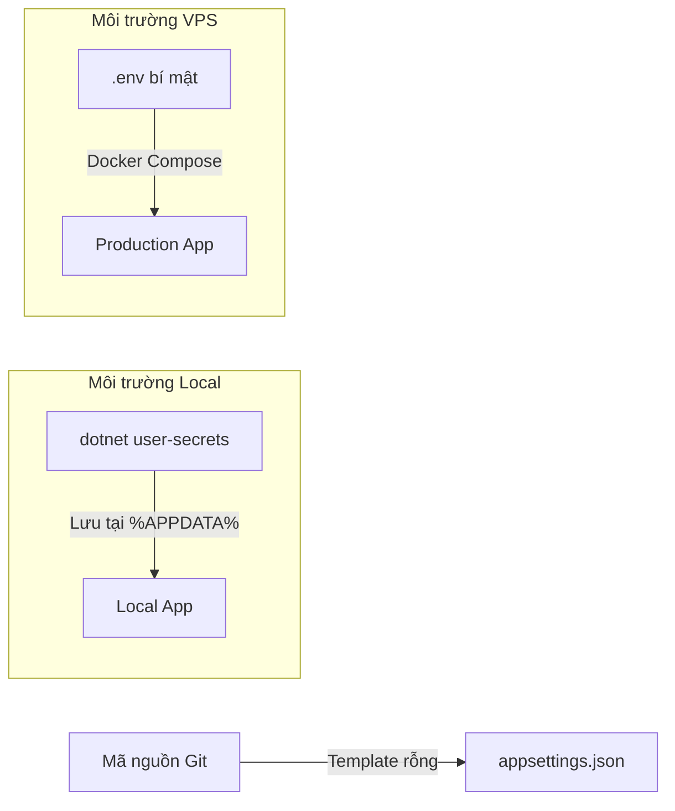

# HomeMatch - Nền Tảng Tìm Kiếm & Quản Lý Nhà Trọ Thông Minh

[](https://dotnet.microsoft.com/)
[](https://nextjs.org/)
[](https://www.postgresql.org/)
[](https://www.docker.com/)
[](https://nginx.org/)

Dự án áp dụng mô hình **Monorepo** kết hợp kiến trúc **Modular Monolith** phân tầng **Clean Architecture**, tối ưu hóa tìm kiếm nhà trọ theo tọa độ địa lý thực tế (PostGIS & Leaflet Map), chat thời gian thực (SignalR) và quy trình quản lý cho thuê toàn diện.

---

## 📑 Mục Lục
1. [Công Nghệ Cốt Lõi](#1-công-nghệ-cốt-lõi)
2. [Cấu Trúc Thư Mục Monorepo](#2-cấu-trúc-thư-mục-monorepo)
3. [Kiến Trúc Module Backend](#3-kiến-trúc-module-backend)
4. [Cơ Chế Bảo Mật & Quản Lý Secrets](#4-cơ-chế-bảo-mật--quản-lý-secrets)
5. [Hướng Dẫn Khởi Chạy (3 Kịch Bản)](#5-hướng-dẫn-khởi-chạy-3-kịch-bản)
   - [Cách 1: Khởi chạy Full-stack qua Docker Compose](#cách-1-khởi-chạy-full-stack-qua-docker-compose-khuyến-nghị)
   - [Cách 2: Khởi chạy Local phục vụ Lập trình viên](#cách-2-khởi-chạy-local-phục-vụ-lập-trình-viên)
   - [Cách 3: Triển khai lên Production VPS](#cách-3-triển-khai-lên-production-vps)
6. [Kiểm Thử & Đảm Bảo Chất Lượng](#6-kiểm-thử--đảm-bảo-chất-lượng)
7. [Quy Chuẩn Git & Quy Tắc Đóng Góp](#7-quy-chuẩn-git--quy-tắc-đóng-góp)

---

## 1. Công Nghệ Cốt Lõi

| Thành phần | Công nghệ chính | Tính năng nổi bật |
| :--- | :--- | :--- |
| **Frontend** | Next.js 15 (App Router), React 19, TypeScript, Tailwind CSS | Standalone Build, Server Components, Leaflet Interactive Map, Geocoding, Lucide Icons |
| **Backend** | ASP.NET Core (.NET 10), C# 13 | Modular Monolith, Clean Architecture, SignalR Realtime Hubs, Scalar & Swagger OpenAPI |
| **Database** | PostgreSQL 16 + PostGIS 3.4 | Đa schema độc lập (`identity`, `properties`, `listings`...), tìm kiếm bán kính không gian địa lý GiST index |
| **Hạ tầng** | Docker & Docker Compose, Nginx Alpine | Multi-stage build, Reverse Proxy SSL Cloudflare, Healthcheck tự động |
| **Tên miền VPS**| `homematch2005.id.vn` | Hỗ trợ Cloudflare Flexible/Full SSL Proxy |

---

## 2. Cấu Trúc Thư Mục Monorepo

```
HomeMatch/
├── frontend/                       # Ứng dụng Next.js 15 (App Router)
│   ├── public/                     # Ảnh, favicon, tài nguyên tĩnh
│   ├── src/
│   │   ├── app/                    # Định tuyến: Auth, Landlord, Tenant, Admin, Listings, Messages...
│   │   ├── components/             # UI Components (Bản đồ Leaflet, Modal, Navbar, Toast...)
│   │   ├── features/               # 9 Module nghiệp vụ frontend (auth, properties, listings...)
│   │   ├── hooks/                  # Custom React Hooks
│   │   ├── lib/                    # API client (Axios), tiện ích định dạng utils
│   │   └── types/                  # Định nghĩa TypeScript dùng chung
│   ├── Dockerfile                  # Multi-stage Next.js standalone container
│   ├── next.config.ts              # Output standalone, Rewrites API
│   └── package.json
│
├── backend/                        # ASP.NET Core (.NET 10) Modular Monolith
│   ├── src/
│   │   ├── HomeMatch.Api/          # Entry point host, Middleware, DI, Routing
│   │   ├── HomeMatch.Shared/       # Contracts, Abstractions (IEntity, Result<T>, ApiResponse<T>)
│   │   └── Modules/                # 8 module nghiệp vụ độc lập:
│   │       ├── Identity/           # Xác thực JWT, OTP Email, Phân quyền
│   │       ├── Properties/         # Bất động sản, phòng trọ, tiện ích
│   │       ├── Listings/           # Tin đăng cho thuê, tìm kiếm PostGIS
│   │       ├── Viewings/           # Lịch hẹn xem phòng
│   │       ├── Messaging/          # Chat thời gian thực (SignalR Hubs)
│   │       ├── Leasing/            # Hợp đồng thuê phòng
│   │       ├── Billing/            # Hóa đơn & thanh toán
│   │       └── Notifications/      # Thông báo hệ thống & Email
│   ├── tests/
│   │   ├── UnitTests/              # Bộ kiểm thử Unit Test xUnit
│   │   └── IntegrationTests/       # Bộ kiểm thử tích hợp API xUnit
│   ├── Dockerfile                  # Multi-stage .NET 10 SDK & Runtime container
│   └── HomeMatch.sln               # Solution kết nối toàn bộ dự án Backend
│
├── infrastructure/                 # Cấu hình hạ tầng & triển khai
│   ├── nginx/
│   │   └── nginx.conf              # Cấu hình Reverse Proxy Nginx & WebSockets
│   ├── database/
│   │   └── init/                   # Script khởi tạo PostGIS & Schema
│   └── scripts/
│       ├── deploy.sh               # Kịch bản triển khai tự động trên VPS
│       └── backup.sh               # Kịch bản sao lưu cơ sở dữ liệu định kỳ
│
├── docs/                           # Tài liệu kỹ thuật dự án
│   ├── architecture/modular-monolith.md
│   ├── database/schema-design.md
│   └── api/api-guidelines.md
│
├── compose.yaml                    # Docker Compose phối hợp toàn bộ dịch vụ
├── .env.example                    # Mẫu khai báo biến môi trường chuẩn
├── AGENTS.md                       # Quy chuẩn phát triển dành cho AI Agent & Đội ngũ
└── README.md
```

---

## 3. Kiến Trúc Module Backend

Mỗi module trong `backend/src/Modules/` hoạt động như một Class Library độc lập, tuân thủ nguyên tắc **Clean Architecture**:

```
ModuleName/
├── Domain/                         # Thực thể cốt lõi, Enums, Domain Events (Không phụ thuộc thư viện ngoài)
├── Application/                    # Use Cases, Commands, Queries, DTOs, Business Rules
├── Infrastructure/                 # EF Core DbContext riêng biệt, Migrations, Repositories
├── Presentation/                   # Minimal API Endpoints (RESTful /api/v1/...)
├── <ModuleName>ModuleExtensions.cs # Đăng ký DI & Map Endpoints tự động vào Host API
└── HomeMatch.Modules.<ModuleName>.csproj
```

> **Quy tắc bất biến:** Không module nào được truy cập trực tiếp `DbContext` hay thực thể nội bộ của module khác. Mọi giao tiếp liên module phải thông qua `HomeMatch.Shared/Contracts` hoặc In-Memory Events.

---

## 4. Cơ Chế Bảo Mật & Quản Lý Secrets

Dự án áp dụng mô hình bảo mật **3 lớp (3-tier security)** để tuyệt đối không làm lộ mật khẩu hoặc API Key lên GitHub:



1. **Trên GitHub:** File `appsettings.json` và `appsettings.Development.json` chỉ chứa khung cấu hình, toàn bộ mật khẩu Gmail và Cloudflare R2 đều để trống `""`.
2. **Khi lập trình ở máy cá nhân (Local):** Sử dụng công cụ chính thức **.NET User Secrets** (`%APPDATA%\Microsoft\UserSecrets\`). Thông tin bí mật nằm hoàn toàn ngoài thư mục Git.
3. **Khi triển khai lên VPS (Production):** Sử dụng file `.env` đặt trực tiếp trên VPS (file này đã được chặn bởi `.gitignore`). Docker Compose sẽ tự động tiêm biến môi trường vào container.

---

## 5. Hướng Dẫn Khởi Chạy (3 Kịch Bản)

### Cách 1: Khởi chạy Full-stack qua Docker Compose (Khuyến nghị)
Đây là cách nhanh nhất để khởi chạy trọn vẹn toàn bộ hệ thống gồm **Nginx Reverse Proxy**, **Frontend Next.js**, **Backend .NET 10** và **Database PostGIS 16**:

```bash
# 1. Tạo file .env từ file mẫu
cp .env.example .env

# 2. Khởi chạy toàn bộ hệ thống ở chế độ nền
docker compose up -d --build
```

#### 🌐 Các địa chỉ truy cập:
* **Ứng dụng qua Reverse Proxy (Nginx):** [http://localhost](http://localhost)
* **Frontend Next.js (Direct):** [http://localhost:3000](http://localhost:3000)
* **Backend API Scalar Documentation:** [http://localhost:5000/scalar/v1](http://localhost:5000/scalar/v1)
* **Backend API Swagger Documentation:** [http://localhost:5000/swagger](http://localhost:5000/swagger)
* **API Health Check:** [http://localhost:5000/health](http://localhost:5000/health)
* **PostgreSQL Database:** `localhost:5433` *(User: `homematch_user`, DB: `homematch_db`)*

---

### Cách 2: Khởi chạy Local phục vụ Lập trình viên

#### Bước 1: Khởi động Database PostGIS trong Docker
```bash
docker compose up -d db
```

#### Bước 2: Cấu hình User Secrets cho Backend (Chỉ làm 1 lần trên máy mới)
```bash
# Thiết lập thông tin gửi mail Gmail (Nếu muốn test gửi mail xác thực)
dotnet user-secrets set "EmailSettings:SenderEmail" "your_email@gmail.com" --project backend/src/HomeMatch.Api
dotnet user-secrets set "EmailSettings:AppPassword" "your_app_password" --project backend/src/HomeMatch.Api

# (Tùy chọn) Kiểm tra danh sách secret đã lưu
dotnet user-secrets list --project backend/src/HomeMatch.Api
```

#### Bước 3: Chạy Backend ASP.NET Core
```bash
dotnet run --project backend/src/HomeMatch.Api
```
> *Backend sẽ tự động chạy EF Core Migrations và Seed dữ liệu mẫu cho toàn bộ các module khi khởi động.*

#### Bước 4: Chạy Frontend Next.js
Mở một terminal mới:
```bash
cd frontend
npm install
npm run dev
```
Truy cập giao diện tại: **http://localhost:3000**.

---

### Cách 3: Triển khai lên Production VPS

1. **Chuẩn bị VPS:**
   * Cài đặt **Docker** và **Docker Compose Plugin**.
   * Mở cổng tường lửa: Port `80` (HTTP) và Port `443` (HTTPS).
   * Trỏ bản ghi DNS `A` của domain `homematch2005.id.vn` và `www.homematch2005.id.vn` về địa chỉ IPv4 của VPS.
   * Trên Cloudflare, bật biểu tượng đám mây cam (**Proxied**) và chọn chế độ SSL/TLS là **Flexible** hoặc **Full**.

2. **Kéo mã nguồn và tạo cấu hình bí mật:**
   ```bash
   git clone https://github.com/GSK7625/HomeMatch.git
   cd HomeMatch
   cp .env.example .env
   nano .env
   ```
   *Cập nhật các biến bí mật trong `.env`:*
   * `POSTGRES_PASSWORD`: Mật khẩu cơ sở dữ liệu mạnh.
   * `Jwt__Secret`: Chuỗi khóa JWT an toàn cho production.
   * `EMAIL_SENDER_EMAIL` & `EMAIL_APP_PASSWORD`: Tài khoản Gmail gửi thông báo.

3. **Chạy kịch bản triển khai tự động:**
   ```bash
   chmod +x infrastructure/scripts/deploy.sh
   ./infrastructure/scripts/deploy.sh
   ```
   *Hệ thống sẽ tự động build image, kích hoạt database migration, chạy healthcheck và khởi chạy qua Nginx.*

---

## 6. Kiểm Thử & Đảm Bảo Chất Lượng

Trước khi tạo commit hoặc tạo Pull Request, toàn bộ mã nguồn phải vượt qua các bước kiểm tra chất lượng tự động:

```bash
# 1. Kiểm tra build toàn bộ Backend (.NET 10)
dotnet build backend/HomeMatch.sln

# 2. Chạy toàn bộ Unit Tests & Integration Tests
dotnet test backend/HomeMatch.sln

# 3. Kiểm tra Lint và Build Frontend (Next.js 15)
cd frontend
npm run build
```

---

## 7. Quy Chuẩn Git & Quy Tắc Đóng Góp

Dự án áp dụng quy chuẩn vận hành nghiêm ngặt được định nghĩa trong [AGENTS.md](AGENTS.md):

1. **Phân nhánh:**
   * Không bao giờ commit hay push trực tiếp vào `main`.
   * Cú pháp đặt tên nhánh tính năng: `feature/<module-name>-<task-name>` (ví dụ: `feature/listings-search-filter`, `feature/identity-user-initials-avatar`).
2. **Quy tắc Commit Message (Bắt buộc):**
   * **Tiêu đề tiếng Việt không dấu (Unaccented Vietnamese)**, ngắn gọn, súc tích.
   * **Chỉ sử dụng 1 dòng duy nhất**, tuyệt đối không viết body dài hay gạch đầu dòng:
     ```bash
     git commit -m "hoan thien api tim kiem phong tro va fix lai toa do"
     git commit -m "cap nhat giao dien trang chu va ban do tuong tac"
     ```
3. **Quy trình Merge:**
   * Luôn tạo Pull Request trỏ vào nhánh **`dev`** để kiểm thử tích hợp trước khi đưa vào **`main`**.

---

## 📄 Bản Quyền & Giấy Phép
Dự án được phát triển và vận hành bởi đội ngũ **HomeMatch Team**. Mọi quyền được bảo lưu.
