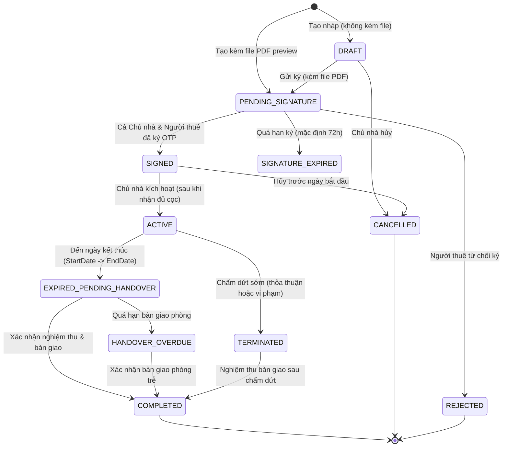

# Leasing Module — Hợp đồng thuê & Quản lý cọc (HomeMatch)

Module `Leasing` chịu trách nhiệm quản lý toàn bộ vòng đời của hợp đồng thuê phòng trọ điện tử, ký hợp đồng số thông qua mã xác thực OTP, lưu trữ tài liệu hợp đồng bảo mật trên Cloudflare R2, và quản lý sổ cái giao dịch tiền cọc (đặt cọc, khấu trừ, hoàn trả).

---

## 1. Kiến trúc Module (Clean Architecture)

Module được cô lập độc lập theo kiến trúc Modular Monolith:
- `Domain/`:
  - Entities: `Contract`, `DepositTransaction`.
  - Enums: `ContractStatus`, `DepositStatus`, `DepositTransactionType`.
  - Constants: `LeasingErrors`.
- `Application/`:
  - `Commands/`: Tạo hợp đồng, gửi ký, yêu cầu OTP, ký hợp đồng, từ chối, hủy, kích hoạt, bàn giao, chấm dứt, ghi nhận cọc, khấu trừ, hoàn cọc.
  - `Queries/`: Xem chi tiết hợp đồng, danh sách hợp đồng theo Chủ nhà / Người thuê, số dư cọc, lịch sử giao dịch cọc, chi tiết bàn giao, lấy presigned URL tài liệu.
  - `Interfaces/`: Cổng giao tiếp persistence (`IContractRepository`), lưu trữ đám mây (`IContractDocumentStorage`), gửi email (`ILeasingEmailService`).
- `Infrastructure/`:
  - `Persistence/`: `LeasingDbContext`, cấu hình EntityTypeConfiguration, EF Core Repositories, Migrations schema `leasing`.
  - `Services/`: `R2DocumentStorageService` (AWS SDK S3 tích hợp Cloudflare R2), `LeasingEmailService` (Google SMTP & fallback Dev Log).
- `Presentation/`:
  - `Endpoints/ContractEndpoints.cs`: Khai báo Minimal APIs RESTful chuẩn `/api/v1/leasing/contracts`.
  - `Endpoints/Requests/` & `Endpoints/Responses/`: Data transfer contracts độc lập cho tầng Presentation.

---

## 2. Vòng đời hợp đồng thuê (State Machine)



---

## 3. Các cơ chế kỹ thuật trọng yếu

1. **Lưu trữ tài liệu bảo mật & Chống gian lận (Cloudflare R2 + SHA-256):**
   - File PDF hợp đồng được tải lên bucket riêng tư trên Cloudflare R2 qua API tương thích S3.
   - Hệ thống tự động tính mã băm `SHA-256` của file tại thời điểm tải lên (`signedDocumentHash`).
   - Khi ký, cả hai bên đều phải gửi kèm mã băm này để đảm bảo nội dung hợp đồng không bị sửa đổi sau khi xuất bản.
   - Để xem trước file, API sinh **Presigned URL** có thời hạn sử dụng giới hạn (mặc định 30 - 60 phút).
2. **Xác thực ký điện tử OTP (ASP.NET Core Identity TOTP):**
   - Mã OTP 6 chữ số được sinh bảo mật từ `UserManager.GenerateUserTokenAsync` gắn liền với mục đích `SignContract:{contractId}`.
   - OTP có thời hạn hiệu lực **5 phút**, được gửi qua email của người ký.
   - **Chế độ Dev Mock:** Khi chưa cấu hình mật khẩu ứng dụng Gmail SMTP, hệ thống sẽ in trực tiếp mã OTP ra log Docker (`docker logs homematch-backend`) để nhà phát triển test nhanh.
3. **Bảo vệ toàn vẹn lịch đặt phòng (PostgreSQL Exclusion Constraint):**
   - Bảng `leasing.contracts` áp dụng `EXCLUDE USING gist (room_id WITH =, daterange(...) WITH &&)` để ngăn chặn tuyệt đối tình trạng 2 hợp đồng cùng đặt một phòng trong các khoảng thời gian giao nhau.
4. **Sổ cái tiền cọc (Deposit Ledger):**
   - Mọi biến động tiền cọc (Nạp cọc, Khấu trừ hư hại, Hoàn trả) đều được ghi nhận dạng bất biến (Immutable Ledger) qua bảng `deposit_transactions`.

---

## 4. Hướng dẫn Test toàn diện trên Swagger UI

- **Địa chỉ Swagger UI:** `http://localhost:5000/swagger`
- **Tài khoản kiểm thử mặc định (Seed Data):**
  - **Chủ nhà (Landlord):** `landlord@homematch.vn` / `Password123@` (User ID: `2`)
  - **Người thuê (Tenant):** `tenant@homematch.vn` / `Password123@` (User ID: `3`)

---

### Bước 0: Chuẩn bị dữ liệu phòng (Prerequisite)
Hợp đồng thuê yêu cầu một phòng trọ hợp lệ (`status = AVAILABLE`) thuộc quyền sở hữu của Chủ nhà.
1. Đăng nhập tài khoản Chủ nhà để lấy Bearer Token.
2. Nếu chưa có phòng, tạo Property qua `POST /api/v1/properties` rồi tạo Room qua `POST /api/v1/properties/{propertyId}/rooms` (ví dụ Room ID: `1`).

---

### Bước 1: Đăng nhập lấy Token & Authorize Swagger
1. Mở endpoint `POST /api/v1/identity/auth/login`.
2. Bấm **Try it out**, nhập JSON:
   ```json
   {
     "email": "landlord@homematch.vn",
     "password": "Password123@"
   }
   ```
3. Bấm **Execute**. Copy chuỗi `accessToken` trong kết quả.
4. Cuộn lên đầu trang Swagger, bấm nút **Authorize** (biểu tượng ổ khóa màu xanh lá), dán `accessToken` vào ô Value rồi bấm **Authorize** ➔ **Close**.

---

### Bước 2: Tạo hợp đồng thuê mới (`POST /api/v1/leasing/contracts`)
Chủ nhà xuất bản hợp đồng kèm file PDF xem trước:
1. Mở `POST /api/v1/leasing/contracts` ➔ Bấm **Try it out**.
2. Điền thông tin vào các ô **Parameters** (phía trên):
   - `RoomId`: `1`
   - `TenantId`: `3`
   - `StartDate`: `2026-12-01`
   - `EndDate`: `2027-11-30`
   - `MonthlyRent`: `4500000`
   - `DepositAmount`: `4500000`
   - `BillingDueDay`: `5`
   - Các trường còn lại (`ContractCode`, `DocumentSnapshot`,...): Để trống.
3. Tại ô **Request body (`file`)**:
   - Bấm **Choose File** và chọn một file PDF bất kỳ từ máy tính.
4. Bấm **Execute**.
5. **Kết quả kỳ vọng (HTTP 201 Created):**
   ```json
   {
     "isSuccess": true,
     "data": {
       "id": 1,
       "contractCode": "HD-20261110-XXXXXX",
       "status": "PENDING_SIGNATURE",
       "signedDocumentHash": "1edb27e7d2e0950df31a5bf8bbc33f5f1e442db35b0611793ab152a0be7386a3",
       "contractFileUrl": "contracts/1/v1/HD-20261110-XXXXXX.pdf"
     }
   }
   ```
   > Lưu lại `id` hợp đồng (ví dụ `1`) và mã `signedDocumentHash` để dùng cho các bước ký tiếp theo.

---

### Bước 3: Lấy link xem/tải tài liệu bảo mật (`GET /api/v1/leasing/contracts/{id}/document`)
1. Mở `GET /api/v1/leasing/contracts/{id}/document`.
2. Điền `id`: `1` ➔ Bấm **Execute**.
3. **Kết quả kỳ vọng (HTTP 200 OK):** Trả về `downloadUrl` (Cloudflare R2 Presigned URL có hạn 30 phút) và `documentHash`. Người dùng có thể paste URL vào trình duyệt để tải và xem nội dung file PDF gốc.

---

### Bước 4: Chủ nhà ký hợp đồng bằng mã OTP
1. **Yêu cầu mã OTP:**
   - Mở `POST /api/v1/leasing/contracts/{id}/request-otp`.
   - Nhập `id`: `1` ➔ Bấm **Execute**.
   - Kiểm tra mã OTP:
     - Nếu có cấu hình Gmail: kiểm tra hòm thư của chủ nhà.
     - Nếu ở môi trường Local/Docker: Mở Terminal chạy `docker logs --tail 20 homematch-backend` để thấy dòng:
       `📧 [DEV MOCK EMAIL] Gửi OTP tới: landlord@homematch.vn | OTP Code: >>> XXXXXX <<<`
2. **Thực hiện ký:**
   - Mở `POST /api/v1/leasing/contracts/{id}/sign`.
   - Nhập `id`: `1`.
   - Request Body:
     ```json
     {
       "otp": "XXXXXX",
       "documentHash": "1edb27e7d2e0950df31a5bf8bbc33f5f1e442db35b0611793ab152a0be7386a3",
       "deviceInfo": "Chrome Windows 11"
     }
     ```
   - Bấm **Execute**. Hợp đồng ghi nhận `landlordSignedAt`, trạng thái vẫn giữ `PENDING_SIGNATURE` chờ Người thuê ký.

---

### Bước 5: Người thuê đăng nhập & ký hợp đồng
1. Đăng nhập tài khoản Người thuê:
   - Gọi `POST /api/v1/identity/auth/login` với:
     ```json
     {
       "email": "tenant@homematch.vn",
       "password": "Password123@"
     }
     ```
   - Copy `accessToken` của người thuê, mở **Authorize** trên Swagger, dán đè token mới vào.
2. **Người thuê yêu cầu OTP:**
   - Mở `POST /api/v1/leasing/contracts/{id}/request-otp` với `id: 1` ➔ Bấm **Execute**.
   - Lấy mã OTP trong log docker: `docker logs --tail 20 homematch-backend`.
3. **Người thuê thực hiện ký:**
   - Mở `POST /api/v1/leasing/contracts/{id}/sign` với `id: 1`.
   - Điền OTP của người thuê và `documentHash` tương tự Bước 4.
   - Bấm **Execute**.
4. **Kết quả kỳ vọng (HTTP 200 OK):**
   - Hợp đồng đã có đủ chữ ký của cả 2 bên.
   - Trạng thái hợp đồng tự động chuyển thành **`SIGNED`**!

---

### Bước 6: Ghi nhận tiền cọc & Kiểm tra số dư
Đổi lại Token của Chủ nhà (`landlord@homematch.vn`):
1. **Ghi nhận đã thu cọc:**
   - Mở `POST /api/v1/leasing/contracts/{id}/deposits/received`.
   - Điền `id: 1`.
   - Request Body:
     ```json
     {
       "amount": 4500000,
       "paymentMethod": "BANK_TRANSFER",
       "note": "Khách chuyển khoản tiền cọc hợp đồng"
     }
     ```
   - Bấm **Execute**. Tiền cọc được ghi nhận, `depositStatus` chuyển thành `PAID`.
2. **Kiểm tra số dư tiền cọc:**
   - Mở `GET /api/v1/leasing/contracts/{id}/deposits/balance` ➔ Bấm **Execute**.
   - Trả về `currentBalance: 4500000`, `holdingAmount: 4500000`.

---

### Bước 7: Kích hoạt hợp đồng (`POST /api/v1/leasing/contracts/{id}/activate`)
1. Mở `POST /api/v1/leasing/contracts/{id}/activate` với `id: 1`.
2. Bấm **Execute**.
3. **Kết quả kỳ vọng (HTTP 200 OK):**
   - Hợp đồng chuyển trạng thái thành **`ACTIVE`**.
   - Phòng trọ tương ứng tự động đồng bộ trạng thái thành `RENTED`.

---

### Bước 8: Bàn giao phòng & Kết thúc hợp đồng (`POST /api/v1/leasing/contracts/{id}/confirm-handover`)
Khi hết hạn thuê hoặc hoàn tất trả phòng:
1. Mở `POST /api/v1/leasing/contracts/{id}/confirm-handover`.
2. Điền `id: 1`.
3. Request Body:
   ```json
   {
     "conditionNotes": "Phòng sạch sẽ, thiết bị hoạt động bình thường",
     "handoverDate": "2027-11-30"
   }
   ```
4. Bấm **Execute**.
5. **Kết quả kỳ vọng (HTTP 200 OK):**
   - Trạng thái chuyển thành **`COMPLETED`**.
   - Phòng trọ tự động chuyển trạng thái về **`AVAILABLE`** sẵn sàng cho khách thuê tiếp theo.

---

### Bước 9: Xử lý tiền cọc khi trả phòng (Khấu trừ / Hoàn cọc)
- **Khấu trừ thiệt hại (nếu có):**
  - Mở `POST /api/v1/leasing/contracts/{id}/deposits/deductions`.
  - Body: `{ "amount": 500000, "reason": "Tiền sơn lại tường bị vẽ bẩn" }`.
- **Hoàn trả cọc còn lại cho khách thuê:**
  - Mở `POST /api/v1/leasing/contracts/{id}/deposits/refunds`.
  - Body: `{ "amount": 4000000, "reason": "Hoàn tiền cọc sau khi trừ chi phí hoàn trả mặt bằng" }`.
  - Số dư cọc về `0`, `depositStatus` chuyển thành `REFUNDED`.

---

## 5. Bảng tra cứu mã lỗi nghiệp vụ (Error Codes)

| Mã lỗi (`code`) | HTTP Status | Nguyên nhân | Hướng khắc phục |
| :--- | :---: | :--- | :--- |
| `Leasing.NotFound` | 404 | Hợp đồng không tồn tại trong hệ thống | Kiểm tra lại `id` hợp đồng trong URL |
| `Leasing.RoomNotFound` | 404 | Không tìm thấy phòng hoặc phòng không tồn tại | Tạo phòng trong module `Properties` trước khi tạo hợp đồng |
| `Leasing.ScheduleConflict` | 409 | Phòng đã có hợp đồng thuê khác trong khoảng thời gian này | Chọn ngày thuê khác hoặc chọn phòng khác |
| `Leasing.UnauthorizedSigner`| 403 | Tài khoản đăng nhập không phải chủ nhà hoặc người thuê của hợp đồng | Đăng nhập đúng tài khoản liên quan đến hợp đồng |
| `Leasing.InvalidOtp` | 400 | Mã OTP sai hoặc đã quá hạn 5 phút | Gọi lại API `request-otp` để nhận mã mới |
| `Leasing.SignatureEvidenceRequired` | 400 | Thiếu mã băm tài liệu `documentHash` khi ký | Lấy mã băm từ API `GET .../document` và gửi vào body |
| `Leasing.DocumentHashMismatch` | 400 | Mã băm tài liệu gửi lên không khớp với bản gốc | Đảm bảo truyền đúng chuỗi `signedDocumentHash` của hợp đồng |
| `Leasing.InvalidStatusTransition` | 400 | Chuyển trạng thái hợp đồng không hợp lệ theo quy trình | Kiểm tra vòng đời máy trạng thái hợp đồng ở Mục 2 |
| `Leasing.InsufficientDepositBalance`| 400 | Số tiền khấu trừ hoặc hoàn trả lớn hơn số dư cọc hiện tại | Kiểm tra lại số dư qua `GET .../deposits/balance` |
