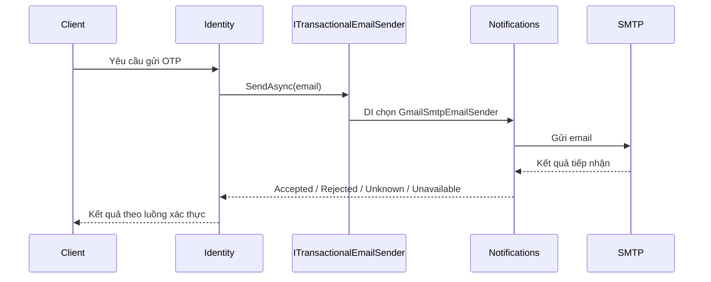
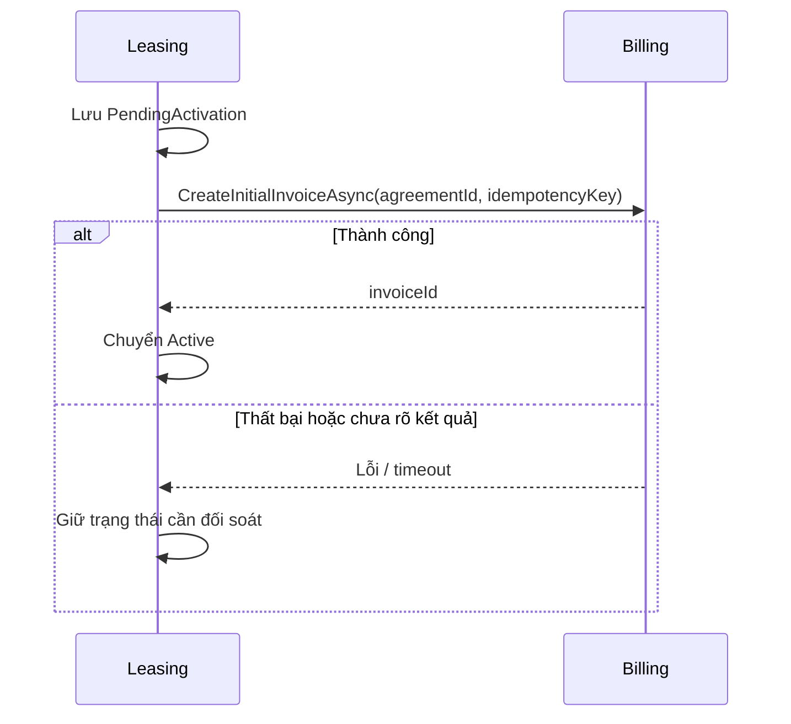

# Ranh giới module và giao tiếp trong HomeMatch

## 1. Phạm vi và trạng thái

HomeMatch là một modular monolith: `HomeMatch.Api` chạy một tiến trình, đăng ký tám module qua Dependency Injection và ánh xạ endpoint của từng module. Mỗi module là một project riêng, có thể tổ chức bốn lớp Domain, Application, Infrastructure và Presentation. Ranh giới module được xác định bằng **nghiệp vụ và quyền sở hữu dữ liệu**, không phải bằng số màn hình hoặc số bảng.

Tài liệu này phân biệt:

- **Đã có trong code:** giao tiếp Identity → Notifications để gửi email xác thực/OTP qua shared contract.
- **Quy tắc thiết kế hoặc luồng dự kiến:** các tương tác giữa Properties, Listings, Viewings, Leasing, Billing, Messaging và Notifications. Hiện các module này phần lớn mới đăng ký service và endpoint `ping`; ví dụ nghiệp vụ dưới đây chưa được xem là API đã triển khai.

## 2. Bounded context là gì và xác định thế nào?

*Bounded context* là phạm vi trong đó một thuật ngữ nghiệp vụ, quy tắc và mô hình dữ liệu có nghĩa thống nhất. Một đối tượng ngoài đời có thể xuất hiện dưới nhiều góc nhìn: `User` ở Identity là tài khoản và trạng thái xác thực; ở Leasing, cùng người đó là bên thuê trong hợp đồng. Hai module chỉ chia sẻ định danh cần thiết, không chia sẻ entity để cùng sửa.

Khi quyết định tách hoặc giữ một module, lần lượt hỏi:

1. **Năng lực nghiệp vụ là gì?** Ví dụ xác thực danh tính, quản lý phòng, đăng tin, đặt lịch xem, ký hợp đồng, lập hóa đơn.
2. **Ai là nguồn sự thật cho dữ liệu và quy tắc?** Module nào được phép thay đổi trạng thái cuối cùng của đối tượng? Ví dụ Billing quyết định hóa đơn đã thanh toán hay chưa.
3. **Ngôn ngữ và vòng đời có khác nhau không?** `Room` có thể đang hoạt động trong Properties nhưng tin đăng tương ứng đang ẩn trong Listings. Trạng thái của hai đối tượng không đồng nhất.
4. **Thay đổi của một nghiệp vụ có thể độc lập đến mức nào?** Nếu quy tắc tính tiền thay đổi, không nên phải sửa entity hợp đồng hoặc tài khoản.
5. **Dữ liệu nào chỉ là tham chiếu hoặc bản sao phục vụ đọc?** Module khác lưu ID hoặc dữ liệu chiếu cần thiết, còn nguồn sự thật vẫn ở module sở hữu.

Một bảng hoặc một endpoint riêng chưa đủ lý do để tạo bounded context. Ngược lại, hai chức năng dùng cùng một người dùng cũng không có nghĩa chúng phải ở cùng module.

### Ranh giới được chọn cho HomeMatch

| Module | Sở hữu nghiệp vụ và dữ liệu | Module khác chỉ nên sử dụng |
|---|---|---|
| Identity | Tài khoản, vai trò Tenant/Landlord, mật khẩu, OTP, phiên và token | User ID, thông tin định danh công khai qua contract khi cần |
| Properties | Bất động sản, phòng, tiện ích và tọa độ gốc | Property/Room ID, thông tin được công bố cho nghiệp vụ khác |
| Listings | Tin đăng, tìm kiếm, dữ liệu tọa độ phục vụ tra cứu, yêu thích trong MVP | Property/Room ID và bản sao dữ liệu cần cho tìm kiếm |
| Viewings | Lịch xem phòng và trạng thái cuộc hẹn | User ID, Listing/Room ID và kết quả kiểm tra đủ điều kiện |
| Messaging | Hội thoại, người tham gia, tin nhắn | User ID và ID ngữ cảnh liên quan |
| Leasing | Hợp đồng, điều khoản, người thuê theo hợp đồng | User/Room ID; kết quả lập hóa đơn từ Billing |
| Billing | Hóa đơn, khoản thu, thanh toán, công nợ | Agreement ID và dữ liệu đầu vào cần tính tiền |
| Notifications | Gửi email/thông báo và kênh phân phối | Dữ liệu tối thiểu để gửi, không sở hữu tài khoản Identity |

Bảng trên mô tả **quyền sở hữu dự kiến** theo kiến trúc dự án, không khẳng định tất cả chức năng đã chạy. `schema-design.md` vẫn ghi ID UUID ở mức quy tắc chung, trong khi Identity hiện dùng BIGINT theo thiết kế SQL 44 bảng; khi làm contract liên module phải dùng đúng kiểu ID thực tế của bên sở hữu và cập nhật tài liệu schema tương ứng.

## 3. Các module giao tiếp với nhau như thế nào?

### 3.1 Cần kết quả ngay: shared contract + DI trong cùng tiến trình

Module gọi chỉ phụ thuộc vào interface và kiểu dữ liệu công khai trong `HomeMatch.Shared/Contracts`. Module cung cấp đăng ký implementation trong DI. Không tham chiếu `DbContext`, repository, entity nội bộ hoặc `IQueryable` của module khác; cũng không gọi HTTP giữa các module trong cùng ứng dụng.

Luồng **đã triển khai** khi gửi OTP qua email:



Contract `ITransactionalEmailSender` nằm trong Shared; `GmailSmtpEmailSender` của Notifications triển khai; Identity gọi contract qua `TransactionalVerificationDelivery` và `PostgresPublicOtpStore`. Kết quả `Accepted` chỉ nói máy chủ SMTP đã tiếp nhận, **không** chứng minh thư đã vào hộp thư.

### 3.2 Thay đổi trạng thái: event và xử lý thất bại

Theo quy tắc backend, domain event xử lý quy tắc nội bộ một module; integration event dùng để báo sự kiện cho module khác trong cùng tiến trình. Đây là **hướng thiết kế**, chưa phải một event bus liên module đã triển khai đầy đủ trong code hiện tại. In-memory event có thể mất nếu tiến trình dừng sau khi lưu dữ liệu nhưng trước khi handler hoàn tất; vì vậy không dùng phát event đơn giản để bảo đảm một bước tài chính quan trọng đã hoàn thành.

Với nghiệp vụ cần kết quả chắc chắn, ví dụ Leasing kích hoạt hợp đồng sau khi Billing lập hóa đơn đầu tiên, quy tắc dự án đề xuất contract đồng bộ, trạng thái `PendingActivation`, khóa idempotency và tác vụ đối soát để thử lại. Luồng này hiện là **thiết kế dự kiến**, không phải chức năng đã có:



Không giả định giao dịch ACID tự động bao trùm hai module chỉ vì chúng dùng cùng PostgreSQL. Phải thiết kế cách retry và chống xử lý trùng trước khi triển khai luồng liên module có tác động tài chính.

### 3.3 Tham chiếu dữ liệu giữa các module

Module tiêu thụ lưu ID của đối tượng ở module nguồn, và có thể lưu bản sao dữ liệu phục vụ đọc/tìm kiếm khi cần. Ví dụ Listings có thể giữ tọa độ để tìm trong bán kính, còn Properties giữ tọa độ gốc. Bản sao cần có cách cập nhật khi nguồn đổi. Không tạo foreign key, navigation property hay cascade delete xuyên schema chỉ để tiện truy vấn; kiểm tra tính hợp lệ qua contract của module sở hữu.

## 4. Vì sao chia thành các module này?

| Ranh giới | Lý do tách | Ví dụ khác biệt về quy tắc |
|---|---|---|
| Identity / Notifications | Identity quyết định mã OTP hợp lệ và quyền truy cập; Notifications chịu trách nhiệm kênh gửi | SMTP tiếp nhận thư không đồng nghĩa email đã xác thực |
| Properties / Listings | Dữ liệu phòng gốc khác vòng đời tin đăng và chỉ mục tìm kiếm | Phòng vẫn tồn tại khi tin đăng bị ẩn |
| Listings / Viewings | Tìm phòng là truy vấn và hiển thị; đặt lịch cần kiểm tra thời gian, trạng thái và người tham gia | Tin đang hiển thị chưa chắc còn khung giờ xem |
| Viewings / Messaging | Cuộc hẹn có trạng thái nghiệp vụ; tin nhắn là trao đổi giữa người dùng | Xóa hội thoại không hủy lịch xem |
| Leasing / Billing | Hợp đồng định nghĩa quan hệ thuê; hóa đơn và thanh toán có vòng đời riêng | Hợp đồng còn hiệu lực dù một kỳ thanh toán quá hạn |

Việc tách giúp mỗi module giữ một nguồn sự thật và quy tắc nhất quán. Điều đó không có nghĩa mỗi module cần một tiến trình hoặc database vật lý riêng: toàn bộ vẫn chạy trong một API và dùng một PostgreSQL với schema theo module.

## 5. Quy tắc kiểm tra khi thêm một tương tác mới

1. Chỉ rõ module sở hữu dữ liệu, module gọi và dữ liệu tối thiểu phải trao đổi.
2. Nếu cần kết quả tức thì, đặt contract ổn định ở Shared và đăng ký implementation bằng DI; không lộ kiểu nội bộ.
3. Nếu phát sự kiện, xác định nhu cầu giao hàng chắc chắn, thứ tự, retry và idempotency trước khi chọn in-memory handler.
4. Dùng ID tham chiếu đúng kiểu hiện hành của module nguồn; tránh FK và truy vấn xuyên schema.
5. Viết test cho contract và tình huống lỗi/timeout; cập nhật tài liệu khi một luồng dự kiến thực sự được triển khai.

## 6. Nguồn đối chiếu

- [`modular-monolith.md`](modular-monolith.md): cấu trúc và nguyên tắc tổng quát.
- [`backend-rules.md`](backend-rules.md): quy tắc giao tiếp, phục hồi và idempotency.
- [`schema-design.md`](../database/schema-design.md) và [`IDENTITY_SCHEMA_MAPPING.md`](../database/IDENTITY_SCHEMA_MAPPING.md): schema và ánh xạ Identity hiện hành.
- `backend/src/HomeMatch.Api/Program.cs`: đăng ký các module vào cùng API.
- `backend/src/HomeMatch.Shared/Contracts/Notifications/ITransactionalEmailSender.cs`: contract email đã dùng thật.
- `backend/src/Modules/Notifications/NotificationsModuleExtensions.cs`: đăng ký implementation của Notifications.

## 7. Đọc code theo luồng: module gọi module như thế nào?

Các liên kết `#L...` bên dưới trỏ đến **dòng của phiên bản code được kiểm tra khi viết tài liệu**. Nếu code thay đổi, hãy tìm theo tên phương thức đi kèm.

### 7.1 Điểm khởi động chung

| Bước | File, dòng | Code thực hiện |
|---|---|---|
| 1 | [`Program.cs:46–53`](../../backend/src/HomeMatch.Api/Program.cs#L46) | `AddIdentityModule(...)` và `AddNotificationsModule(...)` cùng đăng ký dịch vụ vào `IServiceCollection` của một API. Các module khác cũng được đăng ký ở đây. |
| 2 | [`IdentityModuleExtensions.cs:82–86`](../../backend/src/Modules/Identity/IdentityModuleExtensions.cs#L82) | Identity nối `IPublicOtpService` → `PublicOtpService`, `IPublicOtpStore` → `PostgresPublicOtpStore`, cùng các handler gửi/xác thực/đặt lại mật khẩu. |
| 3 | [`NotificationsModuleExtensions.cs:18–21`](../../backend/src/Modules/Notifications/NotificationsModuleExtensions.cs#L18) | Notifications nối `ISmtpSubmissionTransport` → `MailKitSmtpTransport` và `ITransactionalEmailSender` → `GmailSmtpEmailSender`. |
| 4 | [`Program.cs:104–111`](../../backend/src/HomeMatch.Api/Program.cs#L104) | Ánh xạ endpoint của từng module. Đây là route HTTP cho client, **không phải** cách hai module tự gọi nhau. |

Khi `PostgresPublicOtpStore` yêu cầu `ITransactionalEmailSender`, DI tìm implementation `GmailSmtpEmailSender` đã được Notifications đăng ký. Identity không cần tham chiếu project Notifications: cả [`Identity.csproj:14`](../../backend/src/Modules/Identity/HomeMatch.Modules.Identity.csproj#L14) và [`Notifications.csproj:19`](../../backend/src/Modules/Notifications/HomeMatch.Modules.Notifications.csproj#L19) tham chiếu `HomeMatch.Shared`.

### 7.2 Gửi OTP đăng ký hoặc quên mật khẩu: Identity → Notifications → Gmail

1. [`IdentityModuleExtensions.cs:127–132`](../../backend/src/Modules/Identity/IdentityModuleExtensions.cs#L127) tạo nhóm route `/api/v1/identity`; [`IdentityEndpoints.cs:20`](../../backend/src/Modules/Identity/Presentation/IdentityEndpoints.cs#L20) gọi `MapPublicOtp`.
2. [`PublicOtpEndpoints.cs:22–30`](../../backend/src/Modules/Identity/Presentation/PublicOtp/PublicOtpEndpoints.cs#L22) khai báo các route `registration/send-otp`, `forgot-password` và route xác thực tương ứng. Cả hai route gửi đều đi vào cùng handler HTTP, khác `purpose` (`Registration` hoặc `PasswordReset`).
3. [`PublicOtpEndpoints.cs:38–72`](../../backend/src/Modules/Identity/Presentation/PublicOtp/PublicOtpEndpoints.cs#L38) đọc JSON, kiểm tra trường, áp hạn mức yêu cầu rồi gọi `IPublicOtpService.SendAsync(...)` ở dòng 70. Lớp Presentation chưa biết SMTP.
4. [`PublicOtpService.cs:5–12`](../../backend/src/Modules/Identity/Application/PublicOtp/PublicOtpService.cs#L5) chuyển lời gọi đến `SendPublicOtpHandler`; [`SendPublicOtpHandler.cs:9–15`](../../backend/src/Modules/Identity/Application/PublicOtp/SendPublicOtpHandler.cs#L9) chuẩn hóa email, kiểm tra `purpose` và chuyển tiếp cho `IPublicOtpStore`.
5. [`PostgresPublicOtpStore.cs:21–65`](../../backend/src/Modules/Identity/Infrastructure/EmailVerification/PostgresPublicOtpStore.cs#L21) kiểm tra cấu hình, tài khoản, hạn mức; tạo mã sáu số, lưu challenge đã được bảo vệ trong schema Identity. Đối với đăng ký, tài khoản phải tồn tại, mật khẩu đúng và email chưa xác thực; với quên mật khẩu, email phải đã xác thực. Phản hồi cho trường hợp không đủ điều kiện được giữ chung để không lộ sự tồn tại của tài khoản.
6. [`PostgresPublicOtpStore.cs:66–70`](../../backend/src/Modules/Identity/Infrastructure/EmailVerification/PostgresPublicOtpStore.cs#L66) kết thúc transaction trước khi gửi SMTP, tạo `TransactionalEmail` và gọi `sender.SendAsync(...)`. `sender` là `ITransactionalEmailSender`, khai báo tại [`ITransactionalEmailSender.cs:6–10`](../../backend/src/HomeMatch.Shared/Contracts/Notifications/ITransactionalEmailSender.cs#L6). **Đây là điểm gọi xuyên module thực tế.**
7. [`GmailSmtpEmailSender.cs:16–25`](../../backend/src/Modules/Notifications/Infrastructure/Email/GmailSmtpEmailSender.cs#L16) kiểm tra cấu hình và nội dung, sau đó gọi `transport.SubmitAsync(...)`; [`MailKitSmtpTransport.cs:16–32`](../../backend/src/Modules/Notifications/Infrastructure/Email/MailKitSmtpTransport.cs#L16) kết nối SMTP bằng STARTTLS, xác thực và gửi thư.
8. [`PostgresPublicOtpStore.cs:71–78`](../../backend/src/Modules/Identity/Infrastructure/EmailVerification/PostgresPublicOtpStore.cs#L71) nhận `EmailSubmissionOutcome`: nếu SMTP tiếp nhận thì đánh dấu challenge `Submitted`, nếu không thì đóng challenge. Client nhận phản hồi đã gửi theo quy tắc ẩn thông tin tài khoản. `Accepted` nghĩa là SMTP tiếp nhận, không bảo đảm email đã tới hộp thư.

Sơ đồ gọi ngắn gọn:

```text
Client
  → Identity/PublicOtpEndpoints
  → IPublicOtpService / PublicOtpService
  → SendPublicOtpHandler
  → IPublicOtpStore / PostgresPublicOtpStore
  → Shared/ITransactionalEmailSender
  → Notifications/GmailSmtpEmailSender
  → MailKitSmtpTransport → Gmail SMTP
```

**Xác thực OTP và đặt lại mật khẩu không gọi Notifications.** Sau khi người dùng nhập mã, [`PublicOtpEndpoints.cs:70–72`](../../backend/src/Modules/Identity/Presentation/PublicOtp/PublicOtpEndpoints.cs#L70) gọi `VerifyAsync` hoặc `ResetAsync`; [`PostgresPublicOtpStore.cs:82–147`](../../backend/src/Modules/Identity/Infrastructure/EmailVerification/PostgresPublicOtpStore.cs#L82) kiểm tra challenge, cập nhật `EmailConfirmed` hoặc tạo reset token, rồi đổi mật khẩu và thu hồi phiên khi đặt lại. Toàn bộ bước này thuộc Identity.

### 7.3 Luồng gửi mã xác minh email từ phiên đăng nhập

Code hiện có thêm luồng `resend-verification` tách với Public OTP:

1. [`IdentityEndpoints.cs:41–43`](../../backend/src/Modules/Identity/Presentation/IdentityEndpoints.cs#L41) khai báo `resend-verification` và `verify-email`.
2. [`EmailVerificationEndpoints.cs:12–19`](../../backend/src/Modules/Identity/Presentation/EmailVerification/EmailVerificationEndpoints.cs#L12) lấy danh tính hiện tại, đọc request và gọi `RequestEmailVerificationHandler`.
3. [`RequestEmailVerificationHandler.cs:3–12`](../../backend/src/Modules/Identity/Application/EmailVerification/RequestEmailVerificationHandler.cs#L3) tạo yêu cầu gửi qua `IEmailVerificationStore`, rồi gọi `IEmailVerificationDelivery`.
4. [`IdentityModuleExtensions.cs:109`](../../backend/src/Modules/Identity/IdentityModuleExtensions.cs#L109) chọn `TransactionalVerificationDelivery` cho interface này. [`TransactionalVerificationDelivery.cs:10–21`](../../backend/src/Modules/Identity/Infrastructure/EmailVerification/TransactionalVerificationDelivery.cs#L10) dựng email và gọi lại **cùng shared contract** `ITransactionalEmailSender`, sau đó ánh xạ kết quả SMTP sang kết quả của Identity.

Vậy có **hai nơi trong Identity dùng dịch vụ gửi email của Notifications**: Public OTP và luồng xác minh email từ phiên đăng nhập. Cả hai dùng interface chung, không truy cập trực tiếp SMTP hoặc bảng dữ liệu của Notifications.

### 7.4 Các module khác hiện giao tiếp đến đâu?

[`Program.cs:46–53`](../../backend/src/HomeMatch.Api/Program.cs#L46) đã đăng ký Properties, Listings, Viewings, Messaging, Leasing và Billing. Tuy nhiên các file `*ModuleExtensions.cs` tương ứng hiện chủ yếu chứa `TODO` đăng ký service và endpoint `GET /ping`; ví dụ [`PropertiesModuleExtensions.cs:10–22`](../../backend/src/Modules/Properties/PropertiesModuleExtensions.cs#L10) và [`LeasingModuleExtensions.cs:10–22`](../../backend/src/Modules/Leasing/LeasingModuleExtensions.cs#L10). Vì vậy chưa có chuỗi file/dòng để giải thích một lời gọi nghiệp vụ Properties → Listings hay Leasing → Billing **đang chạy**. Các luồng đó ở mục 3–4 là phương án kiến trúc để triển khai sau.

## 8. Vì sao cấu trúc thư mục được chia như vậy?

### 8.1 Ba cấp độ khác nhau: module, lớp và thực thể

```text
backend/src/
├── HomeMatch.Api/                    # Chạy ứng dụng, ghép các module
├── HomeMatch.Shared/                 # Hợp đồng và kiểu dùng chung có chủ đích
└── Modules/
    ├── Identity/                     # Bounded context tài khoản, xác thực
    │   ├── Domain/                   # Trạng thái và quy tắc cốt lõi của Identity
    │   ├── Application/              # Các ca sử dụng: đăng ký, OTP, đăng nhập...
    │   ├── Infrastructure/           # PostgreSQL, EF Core, JWT, bộ mã hóa...
    │   └── Presentation/             # HTTP endpoint, JSON, HTTP error, rate limit
    ├── Properties/                   # Bounded context nhà/phòng
    ├── Listings/                     # Bounded context tin đăng/tìm kiếm
    └── ...
```

**`Modules/Identity` là một module nghiệp vụ. `Identity/Domain` là một lớp của module đó. `Domain/Entities/PublicOtpChallenge.cs` là một thực thể, không phải một “domain” mới.** Từ *domain* đôi khi được dùng để chỉ cả lĩnh vực nghiệp vụ, nên dễ nhầm các cấp này. HomeMatch có nhiều **bounded context/module**, mỗi module có thể có một thư mục `Domain` riêng; trong `Domain` lại có nhiều entity vì một nghiệp vụ có nhiều khái niệm và trạng thái.

Tách `Identity`, `Properties`, `Listings`... ở cấp project để xác định ai sở hữu dữ liệu và quy tắc. Tách `Domain`, `Application`, `Infrastructure`, `Presentation` **bên trong** một project để xác định code phụ thuộc vào đâu. Hai cách chia giải quyết hai câu hỏi khác nhau:

| Câu hỏi | Cấp thư mục trả lời | Ví dụ |
|---|---|---|
| Ai quyết định email đã xác thực? | Module `Identity` | Notifications chỉ gửi email, không sửa `EmailConfirmed`. |
| Quy tắc mã OTP còn hiệu lực nằm ở đâu? | `Identity/Domain` | [`PublicOtpChallenge.cs:22–31`](../../backend/src/Modules/Identity/Domain/Entities/PublicOtpChallenge.cs#L22). |
| Ai điều phối gửi, kiểm tra, đặt lại? | `Identity/Application` | [`PublicOtpService.cs:5–12`](../../backend/src/Modules/Identity/Application/PublicOtp/PublicOtpService.cs#L5). |
| Ai đọc/ghi PostgreSQL? | `Identity/Infrastructure` | [`IdentityDbContext.cs:10–21`](../../backend/src/Modules/Identity/Infrastructure/Persistence/IdentityDbContext.cs#L10). |
| Ai nhận HTTP request? | `Identity/Presentation` | [`PublicOtpEndpoints.cs:22–30`](../../backend/src/Modules/Identity/Presentation/PublicOtp/PublicOtpEndpoints.cs#L22). |

### 8.2 Vì sao `Domain/Entities` có nhiều file?

Một tài khoản không chỉ là một hàng `users`. Xác thực còn có phiên đăng nhập, token làm mới, yêu cầu xác minh email, giới hạn gửi mã và yêu cầu đặt lại mật khẩu. Mỗi đối tượng có **vòng đời và quy tắc riêng**, nên được đặt thành kiểu riêng: `AccountSession`, `RefreshCredential`, `EmailVerificationChallenge`, `EmailVerificationQuota`, `PublicOtpChallenge`, `UserToken`, `UserProfile` trong [`Identity/Domain/Entities`](../../backend/src/Modules/Identity/Domain/Entities). Điều này giúp không nhồi mọi trạng thái vào một class `User` khổng lồ.

Ví dụ [`PublicOtpChallenge.cs:5–31`](../../backend/src/Modules/Identity/Domain/Entities/PublicOtpChallenge.cs#L5) giữ thời điểm hết hạn, số lần nhập sai và quy tắc `CanVerifyAt`/`RejectCode`. Nó không biết HTTP route nào đã gọi nó, không biết cấu hình Gmail và không tự chạy câu SQL. [`IdentityDbContext.cs:15–21`](../../backend/src/Modules/Identity/Infrastructure/Persistence/IdentityDbContext.cs#L15) mới ánh xạ các entity đó ra bảng. **Một entity có thể tương ứng một bảng, nhưng ranh giới module không được quyết định bằng số bảng.**

`Domain/Enums/AccountStatus.cs` chứa trạng thái có nghĩa nghiệp vụ. `Domain/Validation/AccountInput.cs` giữ quy tắc chuẩn hóa đầu vào dùng lại trong Identity. Ngược lại, cách đọc JSON nằm ở Presentation vì đó là chi tiết giao thức HTTP.

### 8.3 Vì sao `Application` lại chia tiếp thành `Registration`, `Login`, `PublicOtp`...?

Các thư mục này nhóm code **theo ca sử dụng** để dễ lần theo một luồng. Chẳng hạn `Application/PublicOtp` có [`IPublicOtpStore.cs:5–10`](../../backend/src/Modules/Identity/Application/PublicOtp/IPublicOtpStore.cs#L5) mô tả việc nghiệp vụ cần lưu/gửi/xác minh mã, các handler cho từng bước, và `PublicOtpResponse` làm kết quả. `Application` gọi interface; nó không phụ thuộc trực tiếp vào `PostgresPublicOtpStore`.

Nhờ vậy, khi sửa quy tắc của bước quên mật khẩu, có thể đi từ `ResetPasswordHandler` xuống store và domain liên quan mà không phải tìm trong một thư mục chứa tất cả service. Việc chia thư mục không yêu cầu mỗi use case trở thành một project hoặc một bounded context mới.

### 8.4 Vì sao `Infrastructure` và `Presentation` có nhiều thư mục con?

`Infrastructure` chứa **cách thực hiện**: [`PostgresPublicOtpStore.cs:17–21`](../../backend/src/Modules/Identity/Infrastructure/EmailVerification/PostgresPublicOtpStore.cs#L17) triển khai `IPublicOtpStore` bằng PostgreSQL; `Persistence/Configurations` chứa ánh xạ EF Core; `Persistence/Migrations` chứa thay đổi cấu trúc database; `Authentication` chứa code JWT và user store; `Passwords` chứa password hasher. Những thứ này thay đổi khi công nghệ lưu trữ hoặc tích hợp thay đổi, dù quy tắc nghiệp vụ có thể giữ nguyên.

`Presentation` chứa **cách công khai** ca sử dụng: route, đọc JSON, xác thực request, giới hạn tần suất và ánh xạ lỗi nghiệp vụ ra HTTP. Ví dụ [`PublicOtpEndpoints.cs:36–85`](../../backend/src/Modules/Identity/Presentation/PublicOtp/PublicOtpEndpoints.cs#L36) kiểm tra request và trả status code; nó không quyết định challenge nào hợp lệ trong database.

### 8.5 Vì sao có `HomeMatch.Shared` và `HomeMatch.Api` ở ngoài module?

[`HomeMatch.Api/Program.cs:46–53`](../../backend/src/HomeMatch.Api/Program.cs#L46) là **composition root**: nơi ghép các module vào một ứng dụng chạy được. Nó không phải nơi đặt logic OTP hoặc tính hóa đơn.

`HomeMatch.Shared` chỉ chứa kiểu hoặc contract cần thiết để các module giao tiếp mà không tham chiếu trực tiếp code nội bộ của nhau. Ví dụ [`ITransactionalEmailSender.cs:6–10`](../../backend/src/HomeMatch.Shared/Contracts/Notifications/ITransactionalEmailSender.cs#L6) cho Identity biết *có thể yêu cầu gửi email và nhận kết quả gì*, còn [`GmailSmtpEmailSender.cs:9–16`](../../backend/src/Modules/Notifications/Infrastructure/Email/GmailSmtpEmailSender.cs#L9) của Notifications quyết định *gửi bằng cách nào*. Không đưa mọi entity, helper hoặc repository vào Shared; làm thế sẽ xóa nhòa quyền sở hữu giữa các module.

### 8.6 Hướng phụ thuộc cần nhớ

```text
HTTP → Presentation → Application → Domain
                         ↑
               Infrastructure triển khai interface Application cần

HomeMatch.Api ghép các implementation qua DI.
Module A → Shared contract ← Module B triển khai.
```

Đây là **hướng phụ thuộc trong thiết kế**, không phải thứ tự thời gian của mọi lời gọi. Lúc chạy, request vẫn có thể đi từ handler sang infrastructure để đọc database hoặc gửi email. Mục tiêu là quy tắc cốt lõi không bị buộc phải biết ASP.NET, EF Core hay Gmail. Cấu trúc thư mục giúp người đọc nhận ra ranh giới đó, nhưng **chỉ tên thư mục không tự bảo đảm kiến trúc**: cần kiểm tra project reference, namespace và các kiểu được import khi review code.
