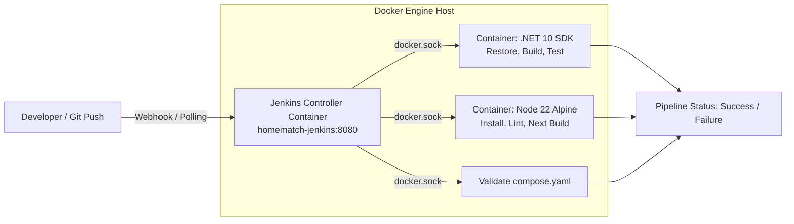

# Hướng Dẫn Cài Đặt, Cấu Hình Jenkins CI & Kích Hoạt Pipeline

Tài liệu này hướng dẫn chi tiết cách thiết lập hệ thống **Jenkins CI** chạy bằng Docker trên máy cá nhân để thay thế hoàn toàn GitHub Actions, tự động hóa toàn bộ quy trình **Build & Test** cho dự án **HomeMatch** (.NET 10 Modular Monolith Backend & Next.js 15 Frontend).

---

## 1. Kiến Trúc & Luồng Hoạt Động (Architecture)



- **Jenkins Controller:** Chạy dưới dạng Docker container `homematch-jenkins` tại cổng `8080`.
- **Docker-out-of-Docker:** Jenkins giao tiếp với Docker Engine của máy host qua socket `/var/run/docker.sock`.
- **Zero-Tool Overhead:** Máy host và Jenkins Controller không cần cài đặt thủ công .NET 10 hay Node.js 22. Mỗi stage trong `Jenkinsfile` tự động khởi chạy Docker container chuyên biệt (`mcr.microsoft.com/dotnet/sdk:10.0` và `node:22-alpine`) để thực thi nhiệm vụ và tự hủy sau khi hoàn thành.

---

## 2. Khởi Động Jenkins Bằng Docker

Tệp cấu hình được đặt tại `infrastructure/jenkins/docker-compose.jenkins.yaml`.

### 2.1. Lệnh khởi chạy

Tại thư mục gốc dự án, thực hiện:

```bash
docker compose -f infrastructure/jenkins/docker-compose.jenkins.yaml up -d --build
```

### 2.2. Kiểm tra trạng thái container

```bash
docker ps -f name=homematch-jenkins
```

Container `homematch-jenkins` sẽ hiển thị cổng `0.0.0.0:8080->8080/tcp` và `50000->50000/tcp`.

---

## 3. Mở Khóa & Cấu Hình Jenkins Lần Đầu

### Bước 1: Lấy mật khẩu quản trị ban đầu (Initial Admin Password)

Chạy lệnh sau trên terminal:

```bash
docker exec homematch-jenkins cat /var/jenkins_home/secrets/initialAdminPassword
```

Sao chép chuỗi mã khóa (ví dụ: `d4ff5d67d76646c79d6192ab68ddcf65`).

### Bước 2: Truy cập Web UI

1. Mở trình duyệt web tại địa chỉ: [http://localhost:8080](http://localhost:8080)
2. Dán mã khóa vừa lấy vào ô **Administrator password** và bấm **Continue**.
3. Chọn **Install suggested plugins** và chờ Jenkins tải các plugin tiêu chuẩn (Git, Pipeline, v.v.).
4. Tạo tài khoản quản trị đầu tiên (**Create First Admin User**) và lưu lại thông tin đăng nhập.

---

## 4. Tạo Pipeline Job Cho HomeMatch

1. Tại Dashboard Jenkins, chọn **New Item**.
2. Nhập tên Job: `HomeMatch-CI`, chọn kiểu **Pipeline** và nhấn **OK**.
3. Trong trang cấu hình:
   - **General:** Đánh dấu chọn **GitHub project** và dán URL repository GitHub của bạn (ví dụ: `https://github.com/<username>/HomeMatch`).
   - **Build Triggers:**
     - Tùy chọn 1 (Dùng Webhook): Chọn **GitHub hook trigger for GITScm polling**.
     - Tùy chọn 2 (Chạy kiểm tra định kỳ không cần mở port ra ngoài): Chọn **Poll SCM** với lịch trình `H/5 * * * *` (kiểm tra mỗi 5 phút).
   - **Pipeline Definition:**
     - Chọn **Pipeline script from SCM**.
     - SCM: Chọn **Git**.
     - Repository URL: Điền link clone GitHub của dự án (ví dụ: `https://github.com/<username>/HomeMatch.git`).
     - Credentials: Thêm GitHub Personal Access Token (PAT) hoặc SSH Key nếu repository ở chế độ Private.
     - Branch Specifier: `*/main` hoặc `*/feature/*` (hoặc để trống nhánh để nhận mọi nhánh).
     - Script Path: `Jenkinsfile`.
4. Nhấn **Save**.

---

## 5. Thiết Lập Kích Hoạt Pipeline Từ GitHub (Webhook)

Để GitHub gửi tín hiệu tự động mỗi khi có `git push` về máy cá nhân:

### Cách 1: Sử dụng Tunnel (Khuyến nghị cho Webhook tức thời)
Vì Jenkins đang chạy trên máy cá nhân (`localhost:8080`), bạn cần public cổng 8080 thông qua công cụ Tunnel như **ngrok** hoặc **Cloudflare Tunnel**:

```bash
# Sử dụng ngrok:
ngrok http 8080
```
- Lấy đường dẫn Forwarding (ví dụ: `https://xxxx-xx-xx.ngrok-free.app`).
- Truy cập GitHub Repo -> **Settings** -> **Webhooks** -> **Add webhook**:
  - **Payload URL:** `https://xxxx-xx-xx.ngrok-free.app/github-webhook/` *(lưu ý dấu gạch chéo `/` ở cuối)*
  - **Content type:** `application/json`
  - **Which events would you like to trigger this webhook?:** `Just the push event` (hoặc Pull Requests).
  - Nhấn **Add webhook**.

### Cách 2: Sử dụng Poll SCM (Hoạt động offline, không cần Tunnel)
Nếu không muốn mở tunnel ra ngoài internet:
- Trong cấu hình Job `HomeMatch-CI`, tại phần **Build Triggers**, tích chọn **Poll SCM**.
- Điền lịch trình: `H/3 * * * *` (Jenkins sẽ tự động thăm dò Git repo mỗi 3 phút, nếu có commit mới sẽ tự động kích hoạt Build).

---

## 6. Kịch Bản Kiểm Thử Build Thành Công & Thất Bại

### 🧪 Kịch bản 1: Build Thành công (Happy Path)
1. Trên giao diện Job `HomeMatch-CI`, nhấn **Build Now** (hoặc push một commit hợp lệ lên GitHub).
2. Quan sát giao diện **Stage View**:
   - `Checkout Code`: Xanh (Passed)
   - `Backend Restore & Build`: Xanh (Passed - Biên dịch thành công 8 modules)
   - `Backend Tests`: Xanh (Passed - 2/2 bài test vượt qua)
   - `Frontend Build & Lint`: Xanh (Passed - Next.js biên dịch hoàn tất 4 static pages)
   - `Validate Docker Compose`: Xanh (Passed)
3. Trạng thái tổng kết build: **SUCCESS** (Màu xanh dương / xanh lá).

### 🧪 Kịch bản 2: Build Thất bại (Failure Path)
Để kiểm chứng khả năng ngăn chặn lỗi sớm của Pipeline:

1. Mở file test backend `backend/tests/UnitTests/UnitTest1.cs`.
2. Cố tình sửa bài kiểm thử thành lỗi:
   ```csharp
   [Fact]
   public void Test1()
   {
       Assert.True(false, "Co tinh tao loi de kiem thu Jenkins Pipeline!");
   }
   ```
3. Commit và push commit này lên nhánh thử nghiệm:
   ```bash
   git commit -am "thu nghiem build that bai tren jenkins"
   git push origin <branch-name>
   ```
4. Pipeline trên Jenkins được kích hoạt tự động:
   - Các stage trước vượt qua bình thường.
   - Khi tới stage **Backend Tests**, bài test bị `FAIL`.
   - Pipeline **ngay lập tức dừng lại**, không chạy các stage tiếp theo.
   - Trạng thái build: **FAILURE** (Màu đỏ).
5. Bấm vào lượt build màu đỏ -> Chọn **Console Output** để xem chi tiết log lỗi: Bạn sẽ thấy chính xác dòng `Assert.True() Failure` cùng vị trí file bị hỏng.

### 🧪 Kịch bản 3: Khôi phục trạng thái xanh (Recovery)
1. Sửa lại `Assert.True(true)` trong `UnitTest1.cs`.
2. Commit và push lại:
   ```bash
   git commit -am "khoi phuc bai test ve trang thai dung"
   git push origin <branch-name>
   ```
3. Pipeline kích hoạt và tất cả stages chuyển lại sang màu xanh (**SUCCESS**).

---

## 7. Các Lệnh Quản Trị Hệ Thống Jenkins

```bash
# Xem log trực tiếp của Jenkins Controller
docker logs -f homematch-jenkins

# Dừng Jenkins (Dữ liệu jobs, build history vẫn được lưu trong volume homematch_jenkins_data)
docker compose -f infrastructure/jenkins/docker-compose.jenkins.yaml down

# Khởi động lại Jenkins
docker compose -f infrastructure/jenkins/docker-compose.jenkins.yaml up -d
```
