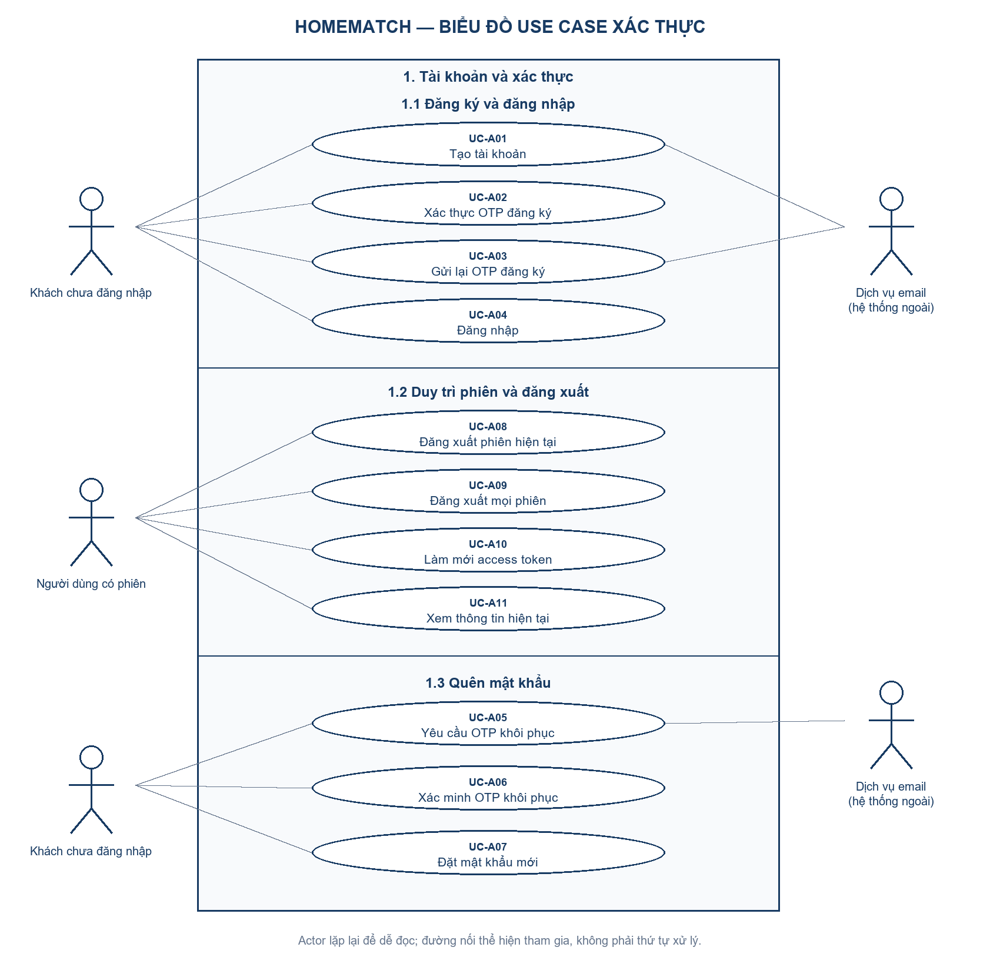

# Biểu đồ use case xác thực HomeMatch

Biểu đồ dưới đây **gộp UC-A01–UC-A11 vào một khung HomeMatch**, chia thành ba vùng tương ứng các nhánh 1.1, 1.2, 1.3 của [sơ đồ phân rã chức năng](SO_DO_PHAN_RA_CHUC_NANG.md). Use case hình bầu dục; actor hình người; đường liền biểu thị tham gia, không biểu thị thứ tự xử lý.

[Bản SVG để phóng to và chèn tài liệu](diagrams/use-case-xac-thuc-tong-hop.svg) · [Mã nguồn tạo hình](diagrams/render_use_case_overview.py).

| Nhánh | Actor | Use case |
|---|---|---|
| 1.1 Đăng ký và đăng nhập | Khách chưa đăng nhập; Dịch vụ email ở bước gửi mã | UC-A01 Tạo tài khoản; UC-A02 Xác thực OTP đăng ký; UC-A03 Gửi lại OTP; UC-A04 Đăng nhập |
| 1.2 Duy trì phiên và đăng xuất | Người dùng có phiên (Tenant/Landlord; Admin nếu được cấp tài khoản) | UC-A08 Đăng xuất phiên; UC-A09 Đăng xuất mọi phiên; UC-A10 Làm mới access token; UC-A11 Xem thông tin hiện tại |
| 1.3 Quên mật khẩu | Khách chưa đăng nhập; Dịch vụ email ở bước gửi mã | UC-A05 Yêu cầu OTP; UC-A06 Xác minh OTP khôi phục; UC-A07 Đặt mật khẩu mới |

Cùng một actor “Khách chưa đăng nhập” và “Dịch vụ email” được vẽ lại ở hai vùng để đường nối dễ đọc; không tạo ra actor hoặc vai trò mới. Tenant và Landlord dùng chung luồng xác thực. Tài khoản Admin không được tự đăng ký qua API công khai. Dịch vụ email là hệ thống ngoài, chỉ tham gia các use case có gửi thư; không trực tiếp xác thực OTP.

Việc phải xác minh OTP trước khi đăng nhập là **điều kiện nghiệp vụ**, không phải quan hệ `include`/`extend` giữa hai use case. Trình tự, điều kiện trước/sau, lỗi và API nằm trong [đặc tả UC-A01–UC-A11](SO_DO_VA_DAC_TA_CHUC_NANG_XAC_THUC.md). `GET /auth/csrf` là bước bảo vệ request trình duyệt, không phải use case nghiệp vụ độc lập. Hai endpoint xác minh email bằng Bearer của luồng cũ còn được giữ trong code nhưng không thay thế OTP công khai khi đăng ký. Nhánh cài đặt tài khoản sẽ cập nhật sau.
