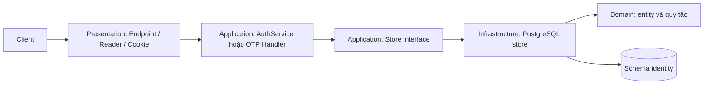

# Identity: kiến trúc, luồng code và ranh giới module

**Đối chiếu mã nguồn:** 01/11/2026. Tài liệu này mô tả code backend hiện có trong workspace, kể cả thay đổi chưa commit. Các module khác ngoài Identity và phần gửi email của Notifications phần lớn mới có đăng ký module và route `/ping`; những nghiệp vụ nhà, tin đăng, hợp đồng trong tài liệu thiết kế chưa phải API đã chạy.

## 1. Ba cấp thường bị gọi chung là “domain”

**Lĩnh vực nghiệp vụ của sản phẩm** là tìm và quản lý phòng trọ. Nó rộng hơn một project. **Module/bounded context** là ranh giới sở hữu một nhóm quy tắc và dữ liệu: `Identity` sở hữu tài khoản, vai trò và phiên; `Notifications` sở hữu việc gửi email; `Properties` dự kiến sở hữu nhà/phòng. Mỗi module là một project riêng trong `backend/src/Modules`.

**Tầng `Domain`** là một thư mục *bên trong* module Identity. Nó chứa trạng thái và quy tắc của tài khoản, phiên và mã xác thực. `Domain/Entities` có nhiều class vì một tài khoản không thể biểu diễn đầy đủ vòng đời của phiên, refresh token và OTP trong một object duy nhất. Ví dụ:

| Kiểu | Quy tắc nó giữ | Mã nguồn |
|---|---|---|
| `AccountSession` | Thời hạn và thu hồi phiên | [AccountSession.cs](../../backend/src/Modules/Identity/Domain/Entities/AccountSession.cs) |
| `RefreshCredential` | Dùng, thay thế và thu hồi refresh token | [RefreshCredential.cs](../../backend/src/Modules/Identity/Domain/Entities/RefreshCredential.cs) |
| `PublicOtpChallenge` | Hạn dùng, số lần thử và trạng thái OTP công khai | [PublicOtpChallenge.cs](../../backend/src/Modules/Identity/Domain/Entities/PublicOtpChallenge.cs) |
| `EmailVerificationChallenge` và `EmailVerificationQuota` | Mã xác minh email và quota gửi/thử | [Domain/Entities](../../backend/src/Modules/Identity/Domain/Entities) |
| `UserProfile`, `UserToken` | Hồ sơ và token bền vững | [Domain/Entities](../../backend/src/Modules/Identity/Domain/Entities) |

Các entity này không đọc HTTP hay gửi SMTP. Việc chuẩn hóa email/tên nằm ở [AccountInput.cs](../../backend/src/Modules/Identity/Domain/Validation/AccountInput.cs#L7). `IdentityAccount` kế thừa ASP.NET Identity và nằm ở Infrastructure vì phụ thuộc framework: [IdentityAccount.cs](../../backend/src/Modules/Identity/Infrastructure/Authentication/IdentityAccount.cs#L7).

### 1.1 Xác định bounded context từ nghiệp vụ như thế nào?

Không lấy số bảng, số màn hình hay số thư mục làm điểm xuất phát. Trước hết mô tả các hành động người dùng và câu hỏi nghiệp vụ của từng hành động: “Ai có quyền đăng nhập?”, “Phòng này còn được phép đăng tin không?”, “Ai được chấp nhận lịch xem?”, “Hợp đồng nào đang có hiệu lực?”. Sau đó xác định **ai là nguồn sự thật** cho mỗi câu trả lời, quy tắc nào phải đúng trong cùng một transaction và bộ phận nào có quyền thay đổi quy tắc đó. Những quy tắc và dữ liệu cần thay đổi cùng nhau thuộc một ngữ cảnh; phần chỉ cần biết kết quả qua ID hoặc contract có thể ở ngữ cảnh khác.

Quy trình thực tế để vạch ranh giới:

1. Liệt kê hành động và trạng thái: đăng ký → xác minh → đăng nhập → thu hồi phiên; tạo phòng → đăng tin → đặt lịch xem → ký hợp đồng → lập hóa đơn.
2. Với mỗi trạng thái, chọn **một nơi sở hữu**. Ví dụ `EmailConfirmed` do Identity quyết định, không phải Notifications; nội dung tin đăng do Listings quyết định, không phải Properties.
3. Gom các quy tắc cần nhất quán tức thời. Đăng nhập phải kiểm tra tài khoản và ghi session/refresh credential cùng luồng Identity. Gửi email là tác dụng bên ngoài, nên không thể nằm trong transaction PostgreSQL đó.
4. Tìm chỗ cùng một từ mang nghĩa khác nhau. “Phòng” trong Properties là tài sản vật lý và trạng thái quản lý; trong Listings chỉ cần ID, mô tả công khai và điều kiện đăng tin; trong Viewings là đối tượng hẹn xem; trong Leasing là đối tượng của hợp đồng. Các module dùng một phần thông tin về phòng, nhưng **Properties là nơi sở hữu bản ghi phòng**.
5. Xác định đầu vào/đầu ra tối thiểu giữa hai ngữ cảnh. Nếu module B chỉ cần biết “phòng có hợp lệ để đăng tin không”, trả lời câu hỏi đó qua contract; không đưa toàn bộ entity hoặc `DbContext` của Properties sang B.
6. Kiểm tra lại khi nghiệp vụ phát triển: nếu hai phần luôn phải sửa và commit cùng nhau, ranh giới có thể đang chia quá nhỏ; nếu một thay đổi nhỏ buộc sửa nhiều module, có thể contract đang để lộ chi tiết nội bộ.

### 1.2 Vì sao HomeMatch chọn các module này?

| Module | Câu hỏi và dữ liệu module sở hữu | Vì sao tách khỏi module bên cạnh | Hiện trạng backend |
|---|---|---|---|
| **Identity** | Ai là người dùng, vai trò, email đã xác minh, phiên/token còn hiệu lực? | Quy tắc bảo mật và vòng đời phiên khác với nhà/phòng hay email vận chuyển; mọi module khác chỉ cần định danh và quyền tối thiểu | API xác thực, schema `identity`, migration và test đã có |
| **Properties** | Nhà, phòng, tiện ích và trạng thái tài sản thuộc ai? | Một phòng có thể tồn tại khi chưa đăng tin hoặc khi tin đã đóng; bản ghi tài sản không nên bị điều khiển bởi vòng đời tin đăng | Project và `/ping`; nghiệp vụ dự kiến |
| **Listings** | Tin nào được công bố, mô tả/giá/cách tìm kiếm công khai ra sao? | Tin đăng có vòng đời xuất bản/tìm kiếm khác vòng đời phòng vật lý | Project và `/ping`; nghiệp vụ dự kiến |
| **Viewings** | Yêu cầu xem phòng ở thời điểm nào, ai chấp nhận/hủy? | Lịch hẹn có trạng thái và quy tắc thời gian riêng; không phải bản thân phòng hay tin | Project và `/ping`; nghiệp vụ dự kiến |
| **Messaging** | Ai tham gia hội thoại, tin nhắn nào được gửi/đọc? | Nội dung trao đổi và quyền riêng tư có vòng đời riêng, không phải trạng thái hợp đồng | Project và `/ping`; nghiệp vụ dự kiến |
| **Leasing** | Hợp đồng nào có hiệu lực, bên thuê/chủ nhà và điều khoản là gì? | Hợp đồng là cam kết pháp lý; tin đăng có thể đóng nhưng hợp đồng vẫn tồn tại | Project và `/ping`; nghiệp vụ dự kiến |
| **Billing** | Khoản phải thu, hóa đơn, thanh toán và đối soát là gì? | Số tiền/trạng thái thanh toán cần quy tắc ghi nhận riêng; không nên sửa trực tiếp hợp đồng khi thanh toán | Project và `/ping`; nghiệp vụ dự kiến |
| **Notifications** | Thông báo được tạo/gửi qua kênh nào, kết quả gửi ra sao? | Module phát sinh sự kiện nghiệp vụ không cần biết chi tiết SMTP hoặc kênh gửi | Gửi email qua shared contract đã có; API nghiệp vụ thông báo khác chưa đầy đủ |

Đây là **ranh giới trách nhiệm**, không phải tám database hoặc tám server. Hiện các project chạy chung trong một API và thiết kế dùng một PostgreSQL với schema theo module. Ranh giới code/dữ liệu vẫn có ích trong cùng process: mỗi module có thể thay đổi nghiệp vụ của mình mà không sửa entity và SQL nội bộ của module khác.

`Domain/Entities` bên trong Identity **không phải các bounded context mới**. `AccountSession` và `RefreshCredential` là hai thực thể của cùng ngữ cảnh Identity vì quy tắc xác thực phiên của chúng gắn với nhau. Nếu tách một module cho từng bảng, một lần refresh sẽ phải gọi xuyên nhiều module chỉ để hoàn tất một transaction bảo mật; ranh giới đó làm nghiệp vụ khó hiểu hơn.

## 2. Vì sao thư mục chia thành bốn tầng?

```text
backend/src/
├── HomeMatch.Api/               Host: khởi động, DI, middleware, ghép route
├── HomeMatch.Shared/            Hợp đồng thực sự cần dùng giữa module
└── Modules/
    ├── Identity/
    │   ├── Domain/              Trạng thái và quy tắc cốt lõi
    │   ├── Application/         Điều phối ca sử dụng và interface cần thiết
    │   ├── Infrastructure/      EF/PostgreSQL, JWT, email adapter
    │   └── Presentation/        HTTP, JSON, cookie, CSRF, rate limit
    └── Notifications/           Gửi email qua shared contract
```

`Presentation` nhận request, quyết định HTTP status/cookie và gọi `Application`. `Application` xác định cần làm gì, phụ thuộc interface như `ILoginStore`, `IRegistrationStore`, `IPublicOtpStore`. `Infrastructure` triển khai các interface và truy cập PostgreSQL hoặc nhà cung cấp email. `Domain` giữ quy tắc trạng thái, tránh phụ thuộc HTTP/EF/SMTP. Một file nhỏ không tự động là “rác”: tách tầng giúp không đưa SQL hoặc cookie vào quy tắc nghiệp vụ. Ngược lại, nhiều file cùng một trách nhiệm đã được gộp: `AuthStores.cs`, `PublicOtpHandlers.cs`, `PublicOtpContracts.cs` và `PostgresEmailVerificationStore.cs`.

Thư mục trong tài liệu kiến trúc tổng thể có thể là cấu trúc **dự kiến**. Các module `Properties`, `Listings`, `Viewings`, `Messaging`, `Leasing`, `Billing` hiện chưa có đầy đủ bốn tầng nghiệp vụ; không nên suy ra API đã tồn tại chỉ vì có project hoặc SQL thiết kế.

## 3. Điểm khởi động và cách một request đi qua các tầng

[Program.cs](../../backend/src/HomeMatch.Api/Program.cs#L46) gọi `AddIdentityModule` cùng `AddNotificationsModule`, để đăng ký dịch vụ vào một container DI. [Program.cs](../../backend/src/HomeMatch.Api/Program.cs#L104) ánh xạ endpoint các module vào cùng ứng dụng ASP.NET. Các lời gọi `Map...Endpoints` chỉ đăng ký route; chúng **không phải** lời gọi nghiệp vụ giữa các module.

[IdentityModuleExtensions.cs](../../backend/src/Modules/Identity/IdentityModuleExtensions.cs#L35) nối interface với implementation: `ILoginStore`/`IRegistrationStore` với lớp PostgreSQL, `IRefreshSessionStore`/`ILogoutSessionStore` với lớp quản lý phiên, `IPublicOtpStore` với store OTP và `IEmailVerificationStore` với store xác minh email. File này cũng đăng ký `AuthService`, reader, rate limiter, cookie và JWT. [IdentityEndpoints.cs](../../backend/src/Modules/Identity/Presentation/IdentityEndpoints.cs#L20) khai báo các route đăng ký, đăng nhập, refresh, logout, OTP, xác minh email và `/me` dưới `/api/v1/identity`.



**Đăng nhập:** [LoginEndpoint.cs](../../backend/src/Modules/Identity/Presentation/Login/LoginEndpoint.cs#L13) kiểm tra yêu cầu HTTP/CSRF, đọc JSON, áp rate limit và gọi `AuthService.LoginAsync`. [AuthService.cs](../../backend/src/Modules/Identity/Application/Authentication/AuthService.cs#L14) chuẩn hóa email và kiểm tra dữ liệu, rồi gọi `ILoginStore`. [AuthStores.cs](../../backend/src/Modules/Identity/Infrastructure/Persistence/AuthStores.cs#L23) xác minh mật khẩu/trạng thái/email, tạo phiên và refresh credential trong transaction, cấp access token; endpoint ghi refresh cookie và trả response. Tham số request nằm ở [AuthRequestDtos.cs](../../backend/src/Modules/Identity/Application/DTOs/AuthRequestDtos.cs).

**Đăng ký:** [RegistrationEndpoint.cs](../../backend/src/Modules/Identity/Presentation/Registration/RegistrationEndpoint.cs#L12) đọc yêu cầu và áp rate limit. [AuthService.RegisterAsync](../../backend/src/Modules/Identity/Application/Authentication/AuthService.cs#L27) kiểm tra email, tên, vai trò và policy mật khẩu. `PostgresRegistrationStore` trong [AuthStores.cs](../../backend/src/Modules/Identity/Infrastructure/Persistence/AuthStores.cs#L96) ghi account/profile. Sau đó endpoint gọi `SendPublicOtpHandler` để yêu cầu OTP; account có thể đã được ghi dù bước gửi email thất bại. Login chỉ thành công sau khi email được xác minh.

**Refresh và logout:** [RefreshEndpoint.cs](../../backend/src/Modules/Identity/Presentation/Refresh/RefreshEndpoint.cs#L12) và [LogoutEndpoints.cs](../../backend/src/Modules/Identity/Presentation/Logout/LogoutEndpoints.cs#L11) xử lý HTTP/cookie. `AuthService` chuyển thao tác đến các store trong [AuthStores.cs](../../backend/src/Modules/Identity/Infrastructure/Persistence/AuthStores.cs#L145). Store khóa bản ghi, kiểm tra trạng thái và commit transaction. Quy tắc thu hồi phiên dùng chung nằm ở [IdentityPersistenceHelpers.cs](../../backend/src/Modules/Identity/Infrastructure/Persistence/IdentityPersistenceHelpers.cs). Tách nó khỏi endpoint để cookie không quyết định trạng thái database.

## 4. Giao tiếp thật giữa Identity và Notifications

Hiện có **một kiểu giao tiếp liên module đang chạy**: Identity cần gửi email. Hợp đồng [ITransactionalEmailSender.cs](../../backend/src/HomeMatch.Shared/Contracts/Notifications/ITransactionalEmailSender.cs#L6) nằm trong `HomeMatch.Shared`, vì hai module đều cần biết interface này. [NotificationsModuleExtensions.cs](../../backend/src/Modules/Notifications/NotificationsModuleExtensions.cs#L14) đăng ký `GmailSmtpEmailSender` làm implementation. Identity chỉ nhận interface qua DI; project Identity không tham chiếu trực tiếp project Notifications.

```mermaid
sequenceDiagram
    participant Client
    participant Endpoint as Identity/PublicOtpEndpoints
    participant Handler as Identity/SendPublicOtpHandler
    participant Store as Identity/PostgresPublicOtpStore
    participant Mail as Shared/ITransactionalEmailSender
    participant Smtp as Notifications/GmailSmtpEmailSender
    Client->>Endpoint: POST gửi OTP
    Endpoint->>Handler: HandleAsync
    Handler->>Store: SendAsync
    Store->>Store: Kiểm tra account, quota; lưu challenge
    Store->>Mail: SendAsync(TransactionalEmail)
    Mail->>Smtp: Implementation do DI nối
    Smtp-->>Store: Kết quả SMTP
    Store-->>Endpoint: Kết quả nghiệp vụ
    Endpoint-->>Client: HTTP response
```

[PublicOtpEndpoints.cs](../../backend/src/Modules/Identity/Presentation/PublicOtp/PublicOtpEndpoints.cs#L21) định nghĩa route gửi, xác minh và đặt lại mật khẩu. [PublicOtpHandlers.cs](../../backend/src/Modules/Identity/Application/PublicOtp/PublicOtpHandlers.cs) kiểm tra đầu vào rồi gọi `IPublicOtpStore` trong [PublicOtpContracts.cs](../../backend/src/Modules/Identity/Application/PublicOtp/PublicOtpContracts.cs). [PostgresPublicOtpStore.cs](../../backend/src/Modules/Identity/Infrastructure/EmailVerification/PostgresPublicOtpStore.cs#L21) kiểm tra tài khoản, lưu OTP dạng bảo vệ và gọi `sender.SendAsync` ở [dòng 71](../../backend/src/Modules/Identity/Infrastructure/EmailVerification/PostgresPublicOtpStore.cs#L71). [GmailSmtpEmailSender.cs](../../backend/src/Modules/Notifications/Infrastructure/Email/GmailSmtpEmailSender.cs#L9) gửi qua transport SMTP. Kết quả SMTP được trả về Identity để cập nhật challenge; Notifications không sửa bảng Identity.

Luồng `resend-verification` cho phiên đã đăng nhập dùng [RequestEmailVerificationHandler.cs](../../backend/src/Modules/Identity/Application/EmailVerification/RequestEmailVerificationHandler.cs#L3), [PostgresEmailVerificationStore.cs](../../backend/src/Modules/Identity/Infrastructure/EmailVerification/PostgresEmailVerificationStore.cs#L10) và [TransactionalVerificationDelivery.cs](../../backend/src/Modules/Identity/Infrastructure/EmailVerification/TransactionalVerificationDelivery.cs#L6). Nó dùng cùng shared contract gửi email. `verify-email` kiểm tra challenge trong Identity và không cần gọi SMTP.

### 4.1 Ai là người điều phối?

Một request HTTP có **một module chủ trì**: module sở hữu ca sử dụng mà client yêu cầu. Với `POST /auth/registration/send-otp`, đó là Identity. Endpoint Identity nhận request, handler/`PostgresPublicOtpStore` quyết định có được tạo OTP hay không, rồi nhờ Notifications gửi email. Notifications chỉ trả kết quả gửi; nó không quyết định tài khoản đã xác minh và không mở `IdentityDbContext`. Tên module trong URL cho biết nơi nhận request, còn interface trong `HomeMatch.Shared` cho biết chỗ vượt ranh giới module.

`Program.cs` ghép các module lúc khởi động, nhưng không điều phối từng nghiệp vụ. Container DI tìm implementation khi một đối tượng yêu cầu interface. Cụ thể, `PostgresPublicOtpStore` nhận `ITransactionalEmailSender` ở [constructor](../../backend/src/Modules/Identity/Infrastructure/EmailVerification/PostgresPublicOtpStore.cs#L17); [NotificationsModuleExtensions.cs](../../backend/src/Modules/Notifications/NotificationsModuleExtensions.cs#L21) đăng ký `GmailSmtpEmailSender` cho interface đó. Vì thế lời gọi trong Identity thực thi code Notifications ở cùng process, **không phải HTTP nội bộ, gọi thẳng class của module kia hay truy cập bảng của nó**.

### 4.2 Chọn cách giao tiếp theo việc cần làm

| Nhu cầu | Cách tổ chức | Tình trạng trong code |
|---|---|---|
| Cần kết quả ngay để hoàn tất request, ví dụ gửi OTP đã được SMTP tiếp nhận hay chưa | Đặt interface và kiểu dữ liệu tối thiểu trong `HomeMatch.Shared/Contracts`; module cung cấp đăng ký implementation qua DI; module gọi chờ `Task` và xử lý kết quả/lỗi | **Đã có**: `ITransactionalEmailSender`, `TransactionalEmail`, `EmailSubmissionOutcome` |
| Một module đổi trạng thái và các module khác có thể phản ứng sau, ví dụ tin đăng cần cập nhật khi nhà/phòng đổi trạng thái | Module sở hữu dữ liệu phát sự kiện mô tả *việc đã xảy ra*; module nhận tự xử lý dữ liệu của mình | **Chưa triển khai** bus/handler sự kiện liên module trong backend hiện tại |
| Chỉ cần giữ ID của đối tượng thuộc module khác | Lưu khóa logic cùng kiểu với ID nguồn; truy vấn module sở hữu qua contract khi cần dữ liệu mới | Là **quy tắc thiết kế** cho các module chưa có nghiệp vụ; Identity hiện dùng `long` cho user ID |

`HomeMatch.Shared/Abstractions` hiện có [IDomainEvent.cs](../../backend/src/HomeMatch.Shared/Abstractions/IDomainEvent.cs), nhưng chỉ có interface này **không đồng nghĩa** đã có cơ chế publish, retry hay xử lý event. Khi triển khai sự kiện thật, nhóm phải quyết định thời điểm phát sau commit, cách tránh xử lý trùng và cách khôi phục khi handler thất bại. Không nên ghi luồng Properties → Listings hoặc Leasing → Billing là đã chạy khi code chỉ có route `/ping`.

### 4.3 Ranh giới transaction và lỗi trong ví dụ gửi email

[PostgresPublicOtpStore.cs](../../backend/src/Modules/Identity/Infrastructure/EmailVerification/PostgresPublicOtpStore.cs#L52) lưu challenge và **commit transaction Identity trước khi gọi SMTP**. [Dòng 71](../../backend/src/Modules/Identity/Infrastructure/EmailVerification/PostgresPublicOtpStore.cs#L71) mới gọi `ITransactionalEmailSender.SendAsync`; vì vậy không giữ khóa database trong lúc chờ mạng. Nếu SMTP báo `Accepted`, store đánh dấu challenge đã gửi; kết quả khác làm challenge đóng. `Accepted` chỉ là máy chủ SMTP tiếp nhận, không chứng minh email đã đến hộp thư.

Đây là hai thao tác ở hai hệ thống khác nhau, không có transaction chung PostgreSQL–SMTP. Nếu tiến trình dừng giữa hai bước, challenge OTP công khai có thể còn ở trạng thái chưa `Submitted` và không thể xác minh; người dùng có thể yêu cầu gửi lại theo quy tắc cooldown. Luồng xác minh email cho phiên đã đăng nhập dùng pending lease riêng. [RequestEmailVerificationHandler.cs](../../backend/src/Modules/Identity/Application/EmailVerification/RequestEmailVerificationHandler.cs#L3) cũng làm rõ ba bước `ReserveAsync` → `delivery.SendAsync` → `CompleteAsync`. Điều này giải thích vì sao luồng gửi email cần lưu trạng thái trước/sau lời gọi liên module thay vì chỉ gọi SMTP rồi giả định thành công.

### 4.4 Ví dụ khi sau này triển khai module khác

Giả sử Listings cần biết một phòng thuộc Properties có được phép đăng tin. Listings sở hữu ca sử dụng “tạo tin”, Properties sở hữu trạng thái phòng. Listings nên gọi **contract đọc tối thiểu** do hai bên thống nhất, chẳng hạn hỏi `roomId` có hợp lệ và được phép đăng hay không. Properties trả dữ liệu cần thiết; Listings tự quyết định tạo tin và ghi schema `listings`. Không truyền entity EF `Room`, không inject `PropertiesDbContext` vào Listings, và không để Properties ghi bảng Listings. Đây là **ví dụ thiết kế**, chưa có interface hoặc endpoint tương ứng trong repo.

Nếu sau này Properties thay đổi trạng thái phòng và Listings cần cập nhật tin đã đăng, lời gọi đồng bộ ngay trong request có thể khiến việc đổi trạng thái phòng phụ thuộc vào Listings. Khi yêu cầu cho phép xử lý sau, một sự kiện kiểu “trạng thái phòng đã đổi” phù hợp hơn: Properties commit thay đổi của mình, Listings nhận sự kiện và tự cập nhật. Trước khi triển khai phải xác định rõ dữ liệu sự kiện, thứ tự xử lý, retry và cách tránh cập nhật lặp. Quy tắc chủ đạo vẫn là **mỗi module sở hữu transaction và bảng của mình**.

### 4.5 Bản đồ giao tiếp theo hành trình thuê phòng

Bảng dưới đây giúp hình dung luồng **dự kiến** khi các module còn lại được triển khai. Nó không khẳng định contract, event hoặc endpoint tương ứng đã có trong code. Mũi tên chỉ bên khởi phát nhu cầu; cột “nguồn sự thật” cho biết module nào quyết định dữ liệu.

| Nhu cầu | Bên cần thông tin → nguồn sự thật | Giao tiếp phù hợp để xem xét | Trạng thái |
|---|---|---|---|
| Xác định người dùng và quyền khi tạo phòng/tin/lịch/hợp đồng | API/module nghiệp vụ → Identity | JWT và policy ở ranh giới HTTP; nếu cần kiểm tra trạng thái tài khoản mới nhất, contract đọc tối thiểu từ Identity | JWT/policy hiện có trong Identity; API nghiệp vụ khác chưa có |
| Tạo tin cho một phòng đang được phép đăng | Listings → Properties | Gọi đồng bộ qua contract trả thông tin cần xác thực; Listings tự ghi tin | Dự kiến |
| Phòng đổi trạng thái làm tin cần ẩn/cập nhật | Properties → Listings | Sự kiện sau khi Properties commit, nếu chấp nhận cập nhật sau | Dự kiến, chưa có bộ phát/nhận sự kiện |
| Đặt lịch từ một tin đang hiển thị | Viewings → Listings; có thể cần Properties | Đọc điều kiện cần tại thời điểm đặt lịch; Viewings tự giữ trạng thái lịch | Dự kiến |
| Gửi lời nhắc hoặc kết quả đặt lịch | Viewings → Notifications | Yêu cầu gửi nếu cần kết quả ngay, hoặc sự kiện nếu gửi sau; Viewings không gọi SMTP trực tiếp | Dự kiến |
| Lập hợp đồng cho phòng và các bên | Leasing → Properties/Identity | Đọc ID/trạng thái tối thiểu; Leasing tự giữ điều khoản và hiệu lực hợp đồng | Dự kiến |
| Tạo kỳ hóa đơn từ hợp đồng có hiệu lực | Billing → Leasing | Đọc điều khoản khi lập kỳ; hoặc nhận sự kiện hợp đồng thay đổi để duy trì bản sao cần thiết | Dự kiến |
| Gửi thông báo hóa đơn đã phát hành | Billing → Notifications | Contract gửi thông báo hoặc sự kiện sau khi hóa đơn được commit | Dự kiến |

Ví dụ, `Listings → Properties` **không** có nghĩa Listings được sửa bảng `properties.rooms`. Listings chỉ hỏi trạng thái cần thiết; Properties trả lời từ dữ liệu mình sở hữu; Listings quyết định kết quả ca sử dụng của mình. Tương tự, Billing không tự sửa bảng hợp đồng khi ghi nhận thanh toán. Các ID được lưu qua ranh giới module là tham chiếu logic, không tạo foreign key xuyên schema.

Khi thiết kế contract mới, cần ghi rõ: câu hỏi cần trả lời, kiểu ID, dữ liệu tối thiểu, module sở hữu, hành vi khi module cung cấp không sẵn sàng, và thời điểm dữ liệu phải còn đúng. Nếu kết quả phải đúng *ngay trong request*, ưu tiên lời gọi đồng bộ. Nếu module nguồn đã hoàn tất việc của mình và module nhận có thể cập nhật sau, cân nhắc sự kiện. Với cơ chế sự kiện chưa có trong code, tài liệu này chỉ nêu tiêu chí chọn cách giao tiếp, không hứa bảo đảm giao nhận hay nhất quán mà hệ thống chưa cài đặt.

## 5. Database, migration và ranh giới dữ liệu

[IdentityDbContext.cs](../../backend/src/Modules/Identity/Infrastructure/Persistence/IdentityDbContext.cs#L9) chỉ ánh xạ dữ liệu Identity trong schema `identity`. Các file `Infrastructure/Persistence/Configurations` định nghĩa cột, index, khóa ngoại **trong module** và check constraint. Một migration duy nhất [InitialCreate](../../backend/src/Modules/Identity/Infrastructure/Persistence/Migrations/20261101031824_InitialCreate.cs) dựng schema từ database trống; migration gồm ràng buộc role, loại token và trigger kiểm tra cùng họ refresh credential. [IdentityModuleExtensions.cs](../../backend/src/Modules/Identity/IdentityModuleExtensions.cs#L124) chỉ áp migration qua thao tác khởi tạo tường minh. `Program.cs` nhận `--initialize-identity` ở [dòng 57](../../backend/src/HomeMatch.Api/Program.cs#L57); khởi động API bình thường không tự migrate.

Identity hiện dùng `BIGINT` cho user/token, `UUID` cho phiên/challenge. Module khác nếu cần `UserId` sẽ lưu đúng kiểu ID do Identity sở hữu và trao đổi qua contract; không tạo foreign key hay navigation EF xuyên schema. `HomeMatch_Database.sql` trong Docker Compose là bản thiết kế schema khác với migration Identity hiện tại, vì vậy không áp `InitialCreate` lên database đã được script đó tạo.

## 6. Cách lần theo một lỗi hoặc thêm một chức năng

1. Tìm route trong [IdentityEndpoints.cs](../../backend/src/Modules/Identity/Presentation/IdentityEndpoints.cs), rồi mở endpoint cụ thể để thấy JSON, CSRF, rate limit, cookie và HTTP status.
2. Theo lời gọi sang `AuthService` hoặc handler trong `Application` để thấy quy tắc đầu vào và interface được yêu cầu.
3. Tìm implementation interface trong [IdentityModuleExtensions.cs](../../backend/src/Modules/Identity/IdentityModuleExtensions.cs), rồi đọc store ở Infrastructure để thấy transaction, SQL và phụ thuộc email.
4. Nếu lỗi liên quan trạng thái, đọc entity trong `Domain/Entities`; nếu liên quan cột/index, đọc `IdentityDbContext`, `Configurations` và migration.
5. Đối chiếu [UnitTests](../../backend/tests/UnitTests/Identity) và [IntegrationTests](../../backend/tests/IntegrationTests). Unit test kiểm tra quy tắc; integration test kiểm tra HTTP, PostgreSQL, migration và ràng buộc dữ liệu.

Các module không gọi thẳng `DbContext` hoặc entity nội bộ của nhau. Khi cần một kết quả ngay, dùng interface/DTO chung trong `HomeMatch.Shared` và DI như trường hợp gửi email. Các sự kiện liên module nêu trong tài liệu kiến trúc là hướng phát triển; hiện chưa có chuỗi nghiệp vụ chạy thật giữa Properties → Listings hay Leasing → Billing để mô tả như chức năng đã hoàn thành.
