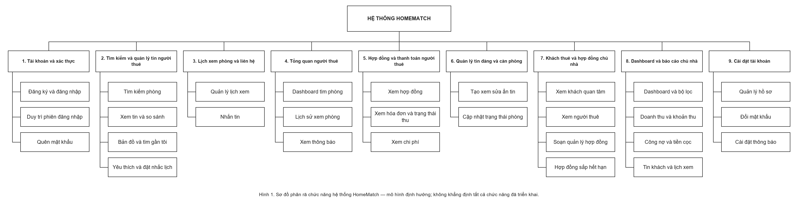
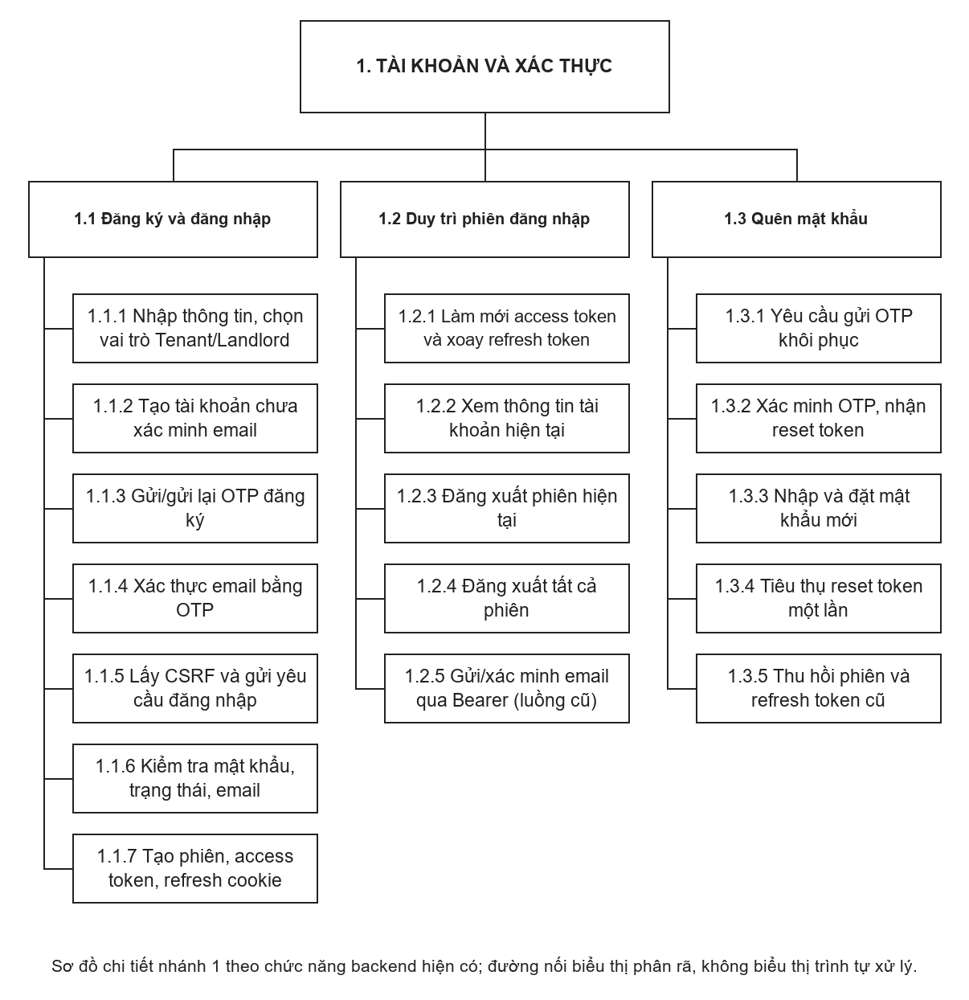

# HomeMatch — Sơ đồ phân rã chức năng

**Cập nhật:** 31/10/2026. Sơ đồ tổng thể bám theo mẫu người dùng cung cấp: “Hệ thống HomeMatch” ở trên, 9 nhóm chức năng ở hàng ngang và chức năng con xếp dọc từng nhánh.

Các nút đều là hình chữ nhật và nối bằng đường gấp khúc không có mũi tên. Chỉ tên 9 nhóm chức năng tổng thể có số thứ tự theo mẫu. Sơ đồ thể hiện quan hệ phân rã, không có actor, use case hay trình tự xử lý.

## 1. Phân rã chức năng tổng thể

[Bản SVG để phóng to hoặc chèn báo cáo](diagrams/phan-ra-chuc-nang-tong-the.svg).

Sơ đồ gồm: (1) Tài khoản và xác thực, (2) Tìm kiếm và quản lý tin người thuê, (3) Lịch xem phòng và liên hệ, (4) Tổng quan người thuê, (5) Hợp đồng và thanh toán người thuê, (6) Quản lý tin đăng và căn phòng, (7) Khách thuê và hợp đồng chủ nhà, (8) Dashboard và báo cáo chủ nhà, (9) Cài đặt tài khoản. Đây là mô hình chức năng theo ảnh tham chiếu, không khẳng định tất cả đã được triển khai. Ô “Ghi nhớ đăng nhập” trong ảnh tham chiếu đã đổi thành “Duy trì phiên đăng nhập” vì API hiện có refresh và thu hồi phiên, nhưng không có tùy chọn Remember Me. Nhánh cài đặt tài khoản giữ để cập nhật sau.

## 2. Phân rã chi tiết chức năng xác thực

[Bản SVG để phóng to hoặc chèn báo cáo](diagrams/phan-ra-chuc-nang-xac-thuc.svg).

| Nhánh | Nội dung |
|---|---|
| 1.1. Đăng ký và đăng nhập | Nhập thông tin, chọn vai trò Tenant/Landlord, tạo tài khoản chưa xác minh, gửi/xác thực OTP; lấy CSRF, kiểm tra mật khẩu/trạng thái/email rồi tạo phiên và token. |
| 1.2. Duy trì phiên đăng nhập | Làm mới access token và xoay refresh token; xem `/me`, đăng xuất phiên hiện tại/tất cả phiên; hai endpoint xác minh email bằng Bearer còn tồn tại cho luồng cũ. |
| 1.3. Quên mật khẩu | Yêu cầu và xác minh OTP, nhận reset token, đặt mật khẩu mới, tiêu thụ token một lần và thu hồi các phiên cũ. |

Cài đặt tài khoản không được đưa vào nhánh chi tiết xác thực. Các thao tác con trong sơ đồ không nhất thiết là màn hình hoặc use case độc lập; ví dụ thu hồi phiên là xử lý bên trong thao tác đặt lại mật khẩu.

## 3. Quy ước mã số

- Hệ thống HomeMatch: nút gốc, không đánh mã trong hình tổng thể.
- `1` đến `9`: Chín nhóm chức năng tổng thể theo ảnh tham chiếu.
- `1.1` đến `1.3`: Ba nhánh của nhóm tài khoản và xác thực, tương ứng thứ tự ở sơ đồ tổng thể.
- `1.1.1`, `1.1.2`, ...: Các chức năng chi tiết trong từng nhánh.

Đường nối là quan hệ cha–con, không phải luồng xử lý. Thứ tự nghiệp vụ đăng ký: nhập thông tin → xác minh OTP → đăng nhập. Thứ tự khôi phục: yêu cầu OTP → xác minh OTP → nhập mật khẩu mới.

## 4. Tài liệu riêng

- [Biểu đồ use case có actor](BIEU_DO_USE_CASE_XAC_THUC.md).
- [Đặc tả chi tiết chức năng và API](SO_DO_VA_DAC_TA_CHUC_NANG_XAC_THUC.md).
- [Mã nguồn tạo ảnh phân rã](diagrams/render_functional_decomposition.py).
