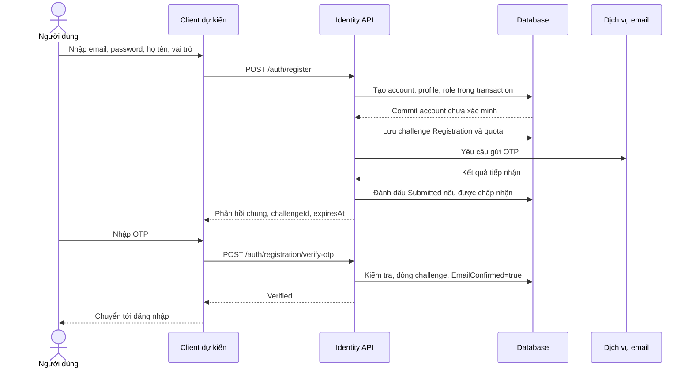
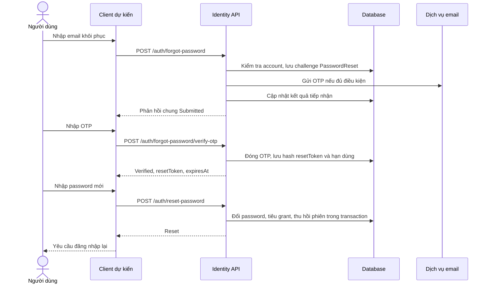
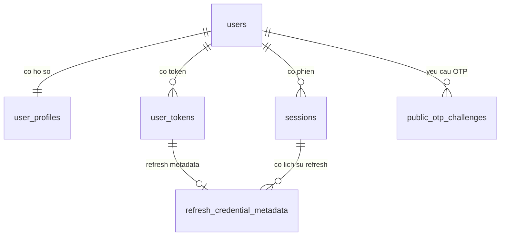
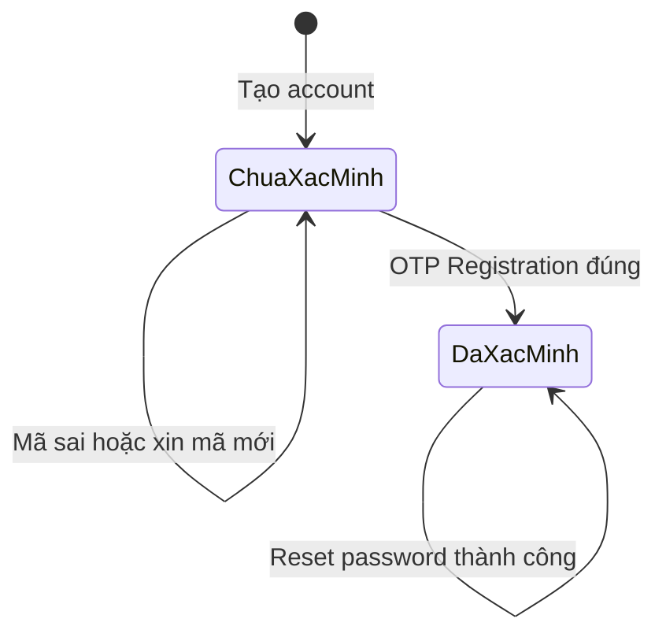
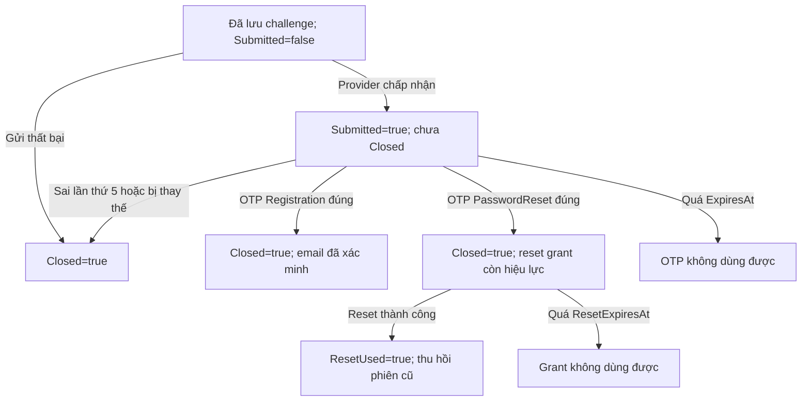

# HomeMatch — Đặc tả chức năng và use case xác thực

**Phiên bản:** 1.2
**Ngày đối chiếu mã nguồn:** 01/11/2026
**Phạm vi chi tiết:** Đăng ký, xác thực OTP, đăng nhập, quên mật khẩu, quản lý phiên và vai trò tài khoản.
**Cài đặt tài khoản:** Giữ chỗ để cập nhật sau; chưa đặc tả trong phiên bản này.

## 1. Phạm vi và trạng thái

HomeMatch phục vụ khách hàng tìm, thuê trọ và chủ nhà cho thuê trọ. Hai nhóm dùng chung luồng xác thực; vai trò được gắn khi đăng ký và đưa vào JWT khi đăng nhập.

Sơ đồ tổng thể là mô hình chức năng theo kiến trúc dự án, không phải danh sách chức năng đã hoàn thành. Các thao tác màn hình dưới đây là luồng nghiệp vụ để xây dựng giao diện; phần đã có hiện nay chủ yếu là backend.

| Nội dung | Trạng thái |
|---|---|
| Đăng ký Tenant/Landlord và yêu cầu gửi OTP | Đã có trong backend |
| Xác thực email trước khi đăng nhập | Đã có trong backend |
| Gửi lại OTP đăng ký khi chưa đăng nhập | Đã có trong backend |
| Đăng nhập, refresh, đăng xuất và đăng xuất mọi phiên | Đã có trong backend |
| Quên mật khẩu: gửi OTP → xác minh → đặt mật khẩu mới | Đã có trong backend |
| Role Tenant/Landlord/Admin, JWT role claim và policy | Đã có nền tảng backend |
| Gắn quyền và kiểm tra sở hữu cho toàn bộ nghiệp vụ nhà/phòng/tin đăng | Chưa hoàn chỉnh |
| Màn hình xác thực trên frontend | Chưa có các màn hình chức năng tương ứng |
| Cài đặt tài khoản | Cập nhật sau |

Tài liệu mô tả mã nguồn trong workspace, gồm các thay đổi chưa commit; không xác nhận migration đã áp dụng vào database đang dùng hoặc SMTP thật đã hoạt động. Tài liệu này thay quy tắc cũ “cho login trước khi xác minh email” đối với luồng đăng ký/login hiện tại.

## 2. Tác nhân và phân quyền

| Mã | Tác nhân | Mô tả |
|---|---|---|
| A01 | Khách chưa đăng nhập | Đăng ký, xác thực đăng ký, đăng nhập và khôi phục truy cập. Đây là trạng thái truy cập, không phải role trong DB. |
| A02 | Khách hàng — Tenant | Người tìm hoặc thuê trọ; đăng ký với role `Tenant`. |
| A03 | Chủ nhà — Landlord | Người cho thuê trọ; đăng ký với role `Landlord`. |
| A04 | Quản trị viên — Admin | Role có trong hệ thống; không được tự đăng ký qua API công khai. Nghiệp vụ quản trị ngoài phạm vi lần này. |
| A05 | Dịch vụ email | Tiếp nhận yêu cầu gửi thư OTP; tiếp nhận SMTP không đồng nghĩa thư đã tới hộp thư. |

Một tài khoản hiện có một vai trò nghiệp vụ. Chưa đặc tả chuyển vai trò hoặc dùng đồng thời Tenant và Landlord.

| Chức năng | Điều kiện quyền hiện tại |
|---|---|
| Đăng ký | API công khai, chỉ nhận Tenant/Landlord. |
| Gửi/xác thực OTP đăng ký | Không cần Bearer; gửi lại cần đúng email/password của account Active chưa xác minh. |
| Đăng nhập | Đúng credential, Active, email đã xác minh; áp dụng cho cả Tenant và Landlord. |
| Quên/đặt lại mật khẩu | Không cần Bearer; chỉ gửi thật cho account Active đã xác minh email. |
| Đọc `/me` | Bearer và phiên hợp lệ, chỉ hồ sơ của chính principal. |
| Refresh/đăng xuất phiên cookie | Refresh cookie tương ứng; Origin/CSRF hợp lệ. Đăng xuất có thể idempotent khi cookie vắng hoặc không nhận diện được. |
| Đăng xuất mọi phiên | Bearer hợp lệ; chỉ các phiên của account Bearer. |
| Cài đặt tài khoản | Chưa đặc tả quyền chi tiết. |

Định hướng ngoài xác thực: Tenant tìm/xem tin và sử dụng dịch vụ thuê; Landlord quản lý nhà, phòng, tin đăng thuộc mình. Đây là định hướng nghiệp vụ, chưa phải xác nhận mọi API đã được bảo vệ bằng policy và kiểm tra ownership.

## 3. Sơ đồ phân rã chức năng

Sơ đồ được tách thành tài liệu và file ảnh riêng, theo bố cục cây chức năng hình chữ nhật: [Sơ đồ phân rã chức năng](SO_DO_PHAN_RA_CHUC_NANG.md).

Tài liệu riêng gồm sơ đồ tổng thể HomeMatch và sơ đồ chi tiết xác thực. Không đặt actor hoặc hình use case trong các ảnh phân rã.

## 4. Biểu đồ use case

Biểu đồ gộp UC-A01–UC-A11, có actor, hình bầu dục và một ranh giới hệ thống, được lưu tại [biểu đồ use case xác thực](BIEU_DO_USE_CASE_XAC_THUC.md).

Các bảng đặc tả ở phần 6 giữ nguyên mã UC-A01 đến UC-A11 để đối chiếu với biểu đồ này. Cài đặt tài khoản vẫn để cập nhật sau.

## 5. Quy tắc nghiệp vụ

| Mã | Quy tắc |
|---|---|
| BR-01 | Nhập thông tin tài khoản trước; account được tạo trước bước người dùng nhập OTP. |
| BR-02 | Account mới có Status=Active, EmailConfirmed=false. Active không đồng nghĩa email đã xác minh. |
| BR-03 | Login yêu cầu đúng password, Active và email đã xác minh; chưa xác minh trả 403 Identity.EmailNotVerified. |
| BR-04 | Tự đăng ký chỉ nhận chính xác Tenant/Landlord; không cho tự đăng ký Admin. |
| BR-05 | Email trim, chuẩn hóa uppercase để tra cứu duy nhất; email trùng không ghi đè credential/profile/role cũ. |
| BR-06 | Password mới: 8–128 Unicode scalar, tối đa 256 đơn vị UTF-16, có chữ và chữ số; không tự trim. |
| BR-07 | Họ tên trim, 2–100 Unicode scalar, không có ký tự điều khiển. |
| BR-08 | OTP là string đúng 6 chữ số ASCII, giữ số 0 đầu; hiệu lực 5 phút từ lúc tạo challenge. |
| BR-09 | Challenge còn hiệu lực bị đóng sau 5 lần mã không khớp. Lỗi cấu trúc hoặc challenge không hợp lệ không đồng nghĩa đã tăng bộ đếm mã sai. |
| BR-10 | OTP Registration và PasswordReset không dùng chéo purpose. |
| BR-11 | Gửi lại đóng challenge cùng account/purpose và đánh dấu reset grant cũ của purpose đó đã dùng. |
| BR-12 | Gửi lại mã đăng ký cần email/password đúng của account Active chưa xác minh. |
| BR-13 | Quên mật khẩu chỉ gửi thật cho account Active đã xác minh email. |
| BR-14 | Verify khôi phục chỉ cấp resetToken, chưa đổi password; token hết hạn sau 5 phút từ lúc verify và dùng một lần. |
| BR-15 | Reset thành công cập nhật credential/stamp, tăng SecurityVersion, thu hồi session/refresh credential và đóng challenge trong transaction. |
| BR-16 | DB lưu MAC OTP và hash resetToken; resetToken không phải access token và không dùng để truy cập API nghiệp vụ. |
| BR-17 | Submitted là phản hồi chung, không chứng minh account tồn tại, credential đúng hoặc thư đã tới. |
| BR-18 | Tạo account đã commit nhưng gửi OTP lỗi thì account có thể vẫn tồn tại chưa xác minh; sau khi dịch vụ sẵn sàng, tiếp tục bằng gửi lại OTP đăng ký. |
| BR-19 | Không tự login sau register, verify hoặc reset; thực hiện đăng nhập riêng. |

Email tối đa 254 ký tự ASCII, đúng kiểm tra MailAddress và chuẩn hóa của backend; không có khoảng trắng bên trong. Body là object JSON UTF-8, tối đa 16 KiB, tên trường phân biệt hoa/thường, không có trường thừa/trùng. `confirmPassword` có thể là kiểm tra giao diện tương lai, không phải trường API nhận hiện tại.

### 5.1. Hạn mức

| Nhóm | Hạn mức | Nơi quản lý |
|---|---|---|
| Đăng ký | 5/15 phút/IP; 3/giờ/email chuẩn hóa | Trong process |
| Login | 10/phút/IP; 5/phút/email chuẩn hóa | Trong process |
| Gửi OTP công khai | 30/phút/IP; 5/15 phút/email chuẩn hóa | Trong process, dùng chung các route gửi công khai |
| Verify OTP công khai và reset | 60/phút/IP | Trong process, dùng chung nhóm verify/reset |
| Gửi OTP công khai theo account | 5/15 phút; 20/24 giờ | DB, chung hai purpose công khai |
| Sender | 100/ngày UTC | DB, chia sẻ với luồng email verification cũ |
| Verify OTP công khai theo account | 20/15 phút | DB, chung hai purpose |
| Gửi lại cùng purpose | 60 giây nếu Submitted; 120 giây nếu chưa được xác nhận Submitted | Theo CreatedAt của challenge |

Vượt quota/cooldown: 429 với Retry-After tính bằng giây. Quota trong process chưa tự đồng bộ giữa nhiều instance. `retryAfterSeconds=60` của response gửi công khai chỉ là hướng dẫn; hạn mức khác có thể làm thời gian chờ dài hơn.

## 6. Đặc tả chi tiết use case

### UC-A01 — Nhập thông tin và tạo tài khoản

| Thuộc tính | Đặc tả |
|---|---|
| Tác nhân/mục tiêu | Khách; lưu thông tin tài khoản trước khi nhập OTP. Dịch vụ email là tác nhân phụ. |
| Tiền điều kiện | DB sẵn sàng, role đã seed; cần cấu hình email/OTP/SMTP để thực sự gửi thư. |
| Kích hoạt | Người dùng hoàn thành biểu mẫu và chọn Đăng ký. |
| Đầu vào | email, password, fullName, role. |
| Luồng chính | 1. Nhập thông tin và chọn Khách hàng/Chủ nhà. 2. Client gửi register. 3. Server kiểm tra dữ liệu/quota. 4. Tạo users (gồm role), user_profiles trong transaction. 5. Tạo challenge Registration, lưu MAC/quota trước khi gọi SMTP. 6. Trả Submitted, challengeId, expiresAt. 7. Giao diện dự kiến chuyển sang nhập OTP, giữ challengeId. |
| A1 — Email trùng | Giữ account cũ. Chỉ gửi nếu account Active, chưa xác minh và password cung cấp khớp; response chung không tiết lộ nhánh. |
| E1 — Đầu vào | 400 dữ liệu sai; 413/415 body/media; 429 quota. |
| E2 — Dependency | 503 tính năng tắt/DB không sẵn sàng. Account đã commit trước lỗi gửi có thể vẫn tồn tại chưa xác minh. |
| E3 — Gửi thư | SMTP từ chối/không rõ kết quả vẫn có thể trả Submitted; challenge không được đánh dấu Submitted sẽ không verify được. Người dùng xin lại mã sau thời gian chờ. |
| Hậu điều kiện | Account mới, nếu được tạo, chưa xác minh và chưa có session. 200 không bảo đảm đã tạo account mới hay có thư. |
| API/bảng | POST /auth/register; users, user_profiles, PublicOtpChallenges, EmailVerificationQuotas. |

### UC-A02 — Xác thực OTP đăng ký

| Thuộc tính | Đặc tả |
|---|---|
| Tác nhân/mục tiêu | Khách; xác minh email để đủ điều kiện đăng nhập. |
| Tiền điều kiện | Challenge Registration Submitted, còn hạn, chưa đóng; account Active chưa xác minh; email/security version vẫn khớp. |
| Kích hoạt/đầu vào | Nhập mã và chọn Xác nhận; challengeId, code; không cần Bearer. |
| Luồng chính | 1. Gửi ID và OTP. 2. Kiểm tra cấu trúc, quota, purpose, trạng thái. 3. Khóa account, so sánh MAC. 4. Đóng challenge và đặt EmailConfirmed=true trong transaction. 5. Trả Verified. 6. Giao diện dự kiến đưa tới login. |
| A1 — Sai mã | Nếu challenge còn dùng được, tăng FailedAttempts; lần thứ 5 đóng challenge. |
| A2 — Cần mã mới | Thực hiện UC-A03 rồi dùng challengeId mới. |
| E1 | OTP sai/hết hạn/đã dùng/sai purpose/account thay đổi: 400 Identity.OtpInvalid. |
| E2 | Sai cấu trúc OTP/UUID: 400 Identity.ValidationFailed; quota: 429; dependency: 503. |
| Hậu điều kiện | Email được xác minh; OTP không dùng lại; chưa cấp JWT/cookie. |
| API/bảng | POST /auth/registration/verify-otp; Users, PublicOtpChallenges, EmailVerificationQuotas. |

### UC-A03 — Gửi lại OTP đăng ký

| Thuộc tính | Đặc tả |
|---|---|
| Tác nhân/mục tiêu | Khách; lấy mã mới khi chưa nhận được hoặc mã hết hiệu lực. |
| Tiền điều kiện gửi thật | Email/password đúng, account Active chưa xác minh; cooldown/quota cho phép; email sẵn sàng. |
| Đầu vào | email, password; không cần JWT. |
| Luồng chính | 1. Yêu cầu gửi lại. 2. Kiểm tra credential/cooldown/quota. 3. Đóng challenge Registration cũ. 4. Tạo challenge mới và yêu cầu gửi thư. 5. Client thay challengeId cũ bằng ID mới. |
| A1 | Account/credential không đủ điều kiện: trả Submitted chung nhưng không gửi thư. |
| E1 | 429 Retry-After khi chưa được gửi; 503 tính năng/dependency không sẵn sàng. |
| Hậu điều kiện | Nếu tạo challenge mới, challenge cũ cùng purpose mất hiệu lực; email chưa tự chuyển sang đã xác minh. |
| API/bảng | POST /auth/registration/send-otp; Users, PublicOtpChallenges, EmailVerificationQuotas. |

### Luồng tuần tự đăng ký



Hình mô tả nhánh account mới và gửi được tiếp nhận; các nhánh lỗi/trùng email nằm trong đặc tả.

### UC-A04 — Đăng nhập

| Thuộc tính | Đặc tả |
|---|---|
| Tác nhân/mục tiêu | Người có account Tenant/Landlord; tạo phiên truy cập. |
| Tiền điều kiện | Đúng password, Active, EmailConfirmed=true; profile/role hợp lệ; Origin/CSRF hợp lệ. |
| Đầu vào | email, password; cookie antiforgery và X-CSRF-TOKEN. |
| Luồng chính | 1. Lấy CSRF và giữ cookie. 2. Nhập email/password. 3. Gửi login. 4. Server kiểm tra guard, quota, dữ liệu và credential. 5. Kiểm tra account/email/role/profile. 6. Tạo session/refresh credential; thu hồi phiên cookie cũ nếu nhận diện phiên đang hợp lệ. 7. Commit, trả JWT/thời hạn và đặt refresh cookie. |
| A1 | Email chưa xác minh: 403 Identity.EmailNotVerified; tiếp tục UC-A03/UC-A02. |
| E1 | Email không tồn tại/password sai: 401 Identity.InvalidCredentials; không tiết lộ email tồn tại. |
| E2 | Account không Active: 403 Identity.AccountSuspended sau kiểm tra credential. |
| E3 | Origin/CSRF sai: 403; dữ liệu sai: 400; quota: 429; dependency: 503. |
| Hậu điều kiện | Có session/JWT mang role. Login thất bại không thay phiên cũ; role không tự cho quyền đối với dữ liệu thuộc account khác. |
| API/bảng | GET /auth/csrf, POST /auth/login; users, user_profiles, sessions, user_tokens, refresh_credential_metadata. |

Không có rememberMe trong contract hiện tại. Mặc định JWT 15 phút, session 24 giờ; dùng thời hạn server trả vì cấu hình chạy có thể khác. Refresh secret chỉ qua cookie HttpOnly, không ở JSON.

### UC-A05 — Yêu cầu khôi phục mật khẩu

| Thuộc tính | Đặc tả |
|---|---|
| Tác nhân/mục tiêu | Người quên password; bắt đầu khôi phục bằng email. |
| Tiền điều kiện gửi thật | Account Active, EmailConfirmed=true; dịch vụ email, quota/cooldown cho phép. |
| Kích hoạt/đầu vào | Chọn Quên mật khẩu, nhập email. |
| Luồng chính | 1. Gửi email. 2. Kiểm tra dữ liệu/quota. 3. Với account đủ điều kiện, đóng challenge PasswordReset cũ, lưu challenge/MAC mới, gửi thư. 4. Trả Submitted chung. 5. Giao diện dự kiến yêu cầu nhập OTP. |
| A1 | Account không tồn tại/chưa xác minh/bị đình chỉ: không gửi nhưng vẫn trả phản hồi chung với ID không có challenge hữu hiệu. |
| A2 | Muốn mã mới: gọi lại cùng route sau cooldown. |
| E1 | Sai email: 400; quota: 429; tính năng tắt/DB lỗi: 503. SMTP không rõ kết quả vẫn có thể có response Submitted. |
| Hậu điều kiện | Chưa đổi password/role/session, chưa cấp resetToken. |
| API/bảng | POST /auth/forgot-password; Users, PublicOtpChallenges, EmailVerificationQuotas. |

### UC-A06 — Xác minh OTP khôi phục

| Thuộc tính | Đặc tả |
|---|---|
| Tác nhân/mục tiêu | Người đang khôi phục; lấy quyền nhập password mới ở bước riêng. |
| Tiền điều kiện | Challenge PasswordReset Submitted còn hiệu lực; account Active đã xác minh; email/security version khớp. |
| Đầu vào | challengeId, code; không yêu cầu JWT/password cũ. |
| Luồng chính | 1. Nhập OTP. 2. Gửi verify khôi phục. 3. Kiểm tra quota/purpose/trạng thái/MAC dưới khóa account. 4. Đóng OTP, sinh resetToken ngẫu nhiên, lưu hash/hạn 5 phút. 5. Trả Verified, resetToken, expiresAt. 6. Giao diện dự kiến giữ token trong bộ nhớ và mở bước password mới. |
| A1 | Sai mã khi challenge còn hợp lệ: tăng counter; sai lần thứ 5 đóng challenge. |
| E1 | Sai/hết hạn/đã dùng/sai purpose: 400 Identity.OtpInvalid; quota: 429; dependency: 503. |
| Hậu điều kiện | Có grant dùng một lần; chưa đổi password/session. OTP đúng không dùng lại để lấy grant mới. |
| API/bảng | POST /auth/forgot-password/verify-otp; Users, PublicOtpChallenges, EmailVerificationQuotas. |

### UC-A07 — Đặt mật khẩu mới

| Thuộc tính | Đặc tả |
|---|---|
| Tác nhân/mục tiêu | Người có resetToken; hoàn tất khôi phục sau OTP. |
| Tiền điều kiện | Token PasswordReset hợp lệ, chưa dùng, còn hạn; account Active đã xác minh; email/security version khớp. |
| Đầu vào | resetToken, newPassword. Nhập lại password có thể được kiểm tra ở UI nhưng không gửi confirmPassword. |
| Luồng chính | 1. Nhập password mới. 2. Gửi reset-password. 3. Kiểm tra policy/hash token. 4. Khóa account, kiểm tra lại grant. 5. Trong transaction: thay PasswordHash và stamp, tăng SecurityVersion, thu hồi session/refresh credential, đóng challenge. 6. Trả Reset. 7. Giao diện dự kiến đưa về login. |
| E1 | Password mới sai policy: 400 ValidationFailed; chưa tiêu token. |
| E2 | Token sai/hết hạn/đã dùng/account thay đổi: 400 OtpInvalid; không đổi credential. |
| E3 | Hai request đồng thời cùng token: chỉ một lần commit thành công. |
| E4 | DB lỗi: không suy ra reset thành công chỉ từ việc client xóa token; transaction bảo vệ thay đổi liên quan. |
| Hậu điều kiện | Password cũ không login được; phiên cũ bị thu hồi; không tự cấp session mới. API không tự xóa cookie browser nhưng credential server đã thu hồi. |
| API/bảng | POST /auth/reset-password; users, public_otp_challenges, user_tokens, sessions, refresh_credential_metadata. |

### Luồng tuần tự quên mật khẩu



### UC-A08 — Đăng xuất phiên hiện tại

| Thuộc tính | Đặc tả |
|---|---|
| Tác nhân/tiền điều kiện | Browser giữ phiên; Origin/CSRF hợp lệ; không cần JWT còn hạn. |
| Luồng chính | 1. Gửi logout kèm cookie/CSRF. 2. Tìm session từ refresh credential, thu hồi family nếu nhận diện được. 3. Xóa refresh cookie, trả 204. 4. Client xóa access token tương ứng. |
| Thay thế/ngoại lệ | Cookie vắng/không nhận diện/đã thu hồi vẫn có thể trả 204. Guard sai: 403; body sai: 400; quota: 429; DB lỗi: 503. |
| Hậu điều kiện | Phiên nhận diện được bị thu hồi; không chọn session qua UserId hoặc Bearer của tab. |
| API/bảng | POST /auth/logout, body rỗng hoặc {}; sessions, user_tokens, refresh_credential_metadata. |

### UC-A09 — Đăng xuất tất cả phiên

| Thuộc tính | Đặc tả |
|---|---|
| Tác nhân/tiền điều kiện | Tenant/Landlord có Bearer và session hợp lệ. |
| Luồng chính | 1. Gửi logout-all. 2. Kiểm tra lại account/session dưới khóa. 3. Thu hồi các phiên/refresh credential của account, tăng SecurityVersion trong transaction. 4. Xóa cookie chỉ nếu thuộc account này. 5. Trả 204. |
| Thay thế/ngoại lệ | Cookie account khác được giữ; Bearer/session sai: 401; quota: 429; dependency: 503. |
| Hậu điều kiện | Các phiên của account Bearer bị thu hồi; không thu hồi phiên account khác. |
| API/bảng | POST /auth/logout-all, body rỗng hoặc {}; users, sessions, user_tokens, refresh_credential_metadata. |

### UC-A10 — Làm mới access token

| Thuộc tính | Đặc tả |
|---|---|
| Tác nhân/tiền điều kiện | Browser có refresh cookie/phiên hợp lệ; Origin/CSRF hợp lệ. |
| Luồng chính | 1. Gửi refresh. 2. Kiểm tra account/session/credential. 3. Đánh dấu credential cũ đã dùng, tạo credential thay thế. 4. Trả JWT mới và đặt cookie mới. |
| Thay thế/ngoại lệ | Credential sai/hết hiệu lực: 401 SessionInvalid, xóa cookie theo endpoint. Reuse credential đã dùng được xử lý chống replay, có thể thu hồi family. Guard: 403; quota: 429; dependency: 503. |
| Hậu điều kiện | Credential xoay trong cùng session; refresh không kéo dài hạn tuyệt đối của session. |
| API/bảng | POST /auth/refresh; users, user_profiles, sessions, user_tokens, refresh_credential_metadata. |

### UC-A11 — Xem thông tin hiện tại

| Thuộc tính | Đặc tả |
|---|---|
| Tác nhân/tiền điều kiện | Tenant/Landlord có Bearer và session hợp lệ. |
| Luồng chính | 1. Gọi /me. 2. Server đối chiếu JWT với account/role/profile/session/SecurityVersion. 3. Trả hồ sơ của principal. |
| Dữ liệu trả | id, email, emailVerified, role, fullName, phoneNumber, createdAt, updatedAt. |
| Ngoại lệ | JWT/session không hợp lệ: 401; không trả password/hash/refresh secret. |
| Giới hạn | Chỉ đọc thông tin để phục vụ xác thực; không đồng nghĩa đã có module sửa/cài đặt tài khoản. |
| API/bảng | GET /me; users, user_profiles, sessions. |

## 7. API contract

Base path: `/api/v1/identity`. JSON camelCase, thời gian UTC ISO 8601; ví dụ là dữ liệu giả lập. Body phản hồi thông thường dùng ApiResponse, ngoại trừ 204 không có body.

```json
{
  "isSuccess": true,
  "data": {},
  "error": null,
  "timestamp": "2026-10-31T03:00:00Z"
}
```

Lỗi có isSuccess=false, data=null, error={code,message}. Login/refresh/logout dùng Origin được phép + cookie antiforgery + X-CSRF-TOKEN; lấy requestToken bằng GET /auth/csrf. Các API OTP công khai mới không yêu cầu Bearer/CSRF trong implementation hiện tại. /me và logout-all dùng Bearer.

### 7.1. Endpoint và contract

| Phương thức | Route | Body | Thành công |
|---|---|---|---|
| POST | /auth/register | email, password, fullName, role | 202 Accepted, PublicOtpResult với status Submitted; chờ xác thực OTP và không tiết lộ email đã tồn tại |
| POST | /auth/registration/send-otp | email, password | 200 PublicOtpResult, Submitted |
| POST | /auth/registration/verify-otp | challengeId, code | 200 PublicOtpResult, Verified |
| GET | /auth/csrf | Không | 200 requestToken và cookie antiforgery |
| POST | /auth/login | email, password | 200 IssuedAccessToken, refresh cookie |
| POST | /auth/forgot-password | email | 200 PublicOtpResult, Submitted |
| POST | /auth/forgot-password/verify-otp | challengeId, code | 200 PublicOtpResult, Verified + resetToken |
| POST | /auth/reset-password | resetToken, newPassword | 200 PublicOtpResult, Reset |
| POST | /auth/refresh | Rỗng hoặc {} | 200 IssuedAccessToken, cookie mới |
| POST | /auth/logout | Rỗng hoặc {} | 204 |
| POST | /auth/logout-all | Rỗng hoặc {} | 204 |
| GET | /me | Không | 200 CurrentUserProfile |

Các route cũ /auth/resend-verification và /auth/verify-email vẫn dùng Bearer; chúng không thay thế các route Registration/PasswordReset cho người chưa login.

### 7.2. Dữ liệu và ví dụ

| Trường | Kiểu/điều kiện |
|---|---|
| email | string bắt buộc; chuẩn hóa/validation theo backend. |
| password đăng ký | string theo BR-06. |
| password login | string 1–128 Unicode scalar, tối đa 256 đơn vị UTF-16; kiểm tra credential cũ. |
| password gửi lại mã đăng ký | string 1–256 đơn vị UTF-16 tại reader; khớp password account để gửi thật. |
| fullName | string theo BR-07. |
| role | string chính xác Tenant hoặc Landlord. |
| challengeId | string UUID dạng D khác UUID rỗng. |
| code | string đúng 6 chữ số ASCII. |
| resetToken | string do verify PasswordReset cấp; khác accessToken. |
| newPassword | string theo policy tạo password mới. |

Ví dụ body đăng ký:

```json
{"email":"an@example.com","password":"Matkhau123","fullName":"Nguyễn Văn An","role":"Tenant"}
```

`data` của response gửi OTP:

```json
{
  "status": "Submitted",
  "challengeId": "c3a06c3d-c59a-4599-b31b-8e72f6c0993a",
  "expiresAt": "2026-10-31T03:05:00Z",
  "resetToken": null,
  "retryAfterSeconds": 60
}
```

Body xác minh OTP, gửi tới đúng route theo purpose:

```json
{"challengeId":"c3a06c3d-c59a-4599-b31b-8e72f6c0993a","code":"012345"}
```

Verify Registration trả status Verified; các trường tùy chọn null, retryAfterSeconds=0. Verify PasswordReset trả `data`:

```json
{
  "status": "Verified",
  "challengeId": null,
  "expiresAt": "2026-10-31T03:07:00Z",
  "resetToken": "<quyen-dat-lai-mat-khau-dung-mot-lan>",
  "retryAfterSeconds": 0
}
```

Body đặt password mới:

```json
{"resetToken":"<quyen-dat-lai-mat-khau-dung-mot-lan>","newPassword":"MatkhauMoi123"}
```

Reset trả status Reset, challengeId/expiresAt/resetToken=null và retryAfterSeconds=0. Các response không trả OTP/password. Login trả accessToken, tokenType=Bearer, expiresIn theo giây, expiresAt, sessionExpiresAt. Refresh cookie là `__Secure-HM.Refresh` (HTTP localhost Development: `HM.Refresh.Dev`), path `/api/v1/identity`, HttpOnly, SameSite=Lax, Secure trừ ngoại lệ local; là session cookie.

### 7.3. Mã lỗi

| HTTP | Code | Ý nghĩa |
|---|---|---|
| 400 | Identity.ValidationFailed | Cấu trúc/dữ liệu sai hoặc password mới không đạt policy. |
| 400 | Identity.OtpInvalid | OTP/challenge/reset grant sai, hết hạn, đã dùng hoặc không còn hợp lệ. |
| 401 | Identity.InvalidCredentials | Sai email/password login. |
| 401 | Identity.AuthenticationRequired / Identity.SessionInvalid | Thiếu credential hoặc phiên không hợp lệ, tùy endpoint. |
| 403 | Identity.EmailNotVerified | Email chưa xác minh. |
| 403 | Identity.AccountSuspended | Account không Active. |
| 403 | Identity.OriginNotAllowed / Identity.CsrfInvalid | Guard trình duyệt không đạt. |
| 413 / 415 | Identity.RequestTooLarge / Identity.UnsupportedMediaType | Body quá lớn hoặc media/encoding sai. |
| 429 | Identity.RateLimitExceeded | Quota/cooldown; đọc Retry-After. |
| 503 | Server.DependencyUnavailable | Tính năng email/dependency chưa sẵn sàng. |

## 8. Dữ liệu và chuyển trạng thái

### 8.1. Các bảng liên quan

Tất cả thuộc schema `identity`.

| Bảng | Vai trò/cột chính |
|---|---|
| `users` | `id BIGINT`, email, password_hash, role, status, email_confirmed, security_version; credential, quyền và trạng thái account. |
| `user_profiles` | `user_id BIGINT`, full_name, avatar_url, date_of_birth, gender, các cờ thông báo, updated_at; hồ sơ. Số điện thoại nằm trong `users`. |
| `sessions` | id UUID kỹ thuật, user_id BIGINT, security_version, created_at, expires_at, revoked_at. |
| `user_tokens` | id/user_id BIGINT, token_hash, token_type, expires_at, created_at; token REFRESH/RESET_PASSWORD. |
| `refresh_credential_metadata` | Liên kết 1–1 với `user_tokens`; session_id, used_at, revoked_at, replaced_by_credential_id. |
| `public_otp_challenges` | Id, UserId, Purpose, Email, SecurityVersion, CodeMac, KeyId, CreatedAt, ExpiresAt, Submitted, Closed, FailedAttempts, ResetTokenHash, ResetExpiresAt, ResetUsed. |
| `email_verification_quotas` | Key, WindowStart, WindowEnd, Count; quota sender/account/verify. |
| `email_verification_challenges` | Bảng của luồng email verification cũ dùng Bearer; không thay PublicOtpChallenges của hai luồng mới. |



ER trên minh họa quan hệ chính theo nghiệp vụ; quota dùng khóa logic, không có FK trực tiếp tới account/sender. Account (gồm role) và profile được tạo cùng transaction.

### 8.2. Trạng thái email



Trạng thái email tách khỏi Status=Active/Suspended và trạng thái session. Sai OTP chỉ đóng challenge, không tự Suspend account. Guard email mới nằm ở luồng login; không khẳng định migration tự thu hồi các phiên unverified đã tồn tại từ phiên bản cũ.

### 8.3. Trạng thái OTP và reset grant



Hết hạn được kiểm tra qua timestamp khi xử lý request, không yêu cầu job đổi Closed đúng thời điểm. Các nhãn trên là trạng thái logic; bảng mới dùng cờ boolean và timestamp, không phải enum có cùng tên.

## 9. Tiêu chí nghiệm thu

| Mã | Tình huống | Kết quả cần đạt |
|---|---|---|
| AC-01 | Đăng ký Tenant/Landlord hợp lệ | Account/profile/role đúng, email chưa xác minh, chưa tạo session. |
| AC-02 | Role Admin/trường thừa/dữ liệu sai | Từ chối, không tự nâng quyền. |
| AC-03 | Email trùng, thông tin khác | Không ghi đè account cũ. |
| AC-04 | Login đúng password nhưng chưa verify | 403 EmailNotVerified. |
| AC-05 | OTP Registration đúng rồi login | Email verified, JWT đúng role. |
| AC-06 | OTP sai 5 lần/hết hạn/đã dùng | Từ chối xác minh; đóng challenge khi đạt số lần sai. |
| AC-07 | Gửi lại mã | Challenge cũ mất hiệu lực; dùng ID/mã mới. |
| AC-08 | OTP dùng chéo purpose | Bị từ chối. |
| AC-09 | Verify khôi phục đúng | Có resetToken; chưa đổi password/session ở bước verify. |
| AC-10 | Reset hợp lệ | Password mới đúng, password cũ sai, phiên cũ thu hồi. |
| AC-11 | Token dùng lại/hai reset đồng thời | Chỉ một lần thành công. |
| AC-12 | Grant hết hạn/account thay đổi | Từ chối reset, không thay credential. |
| AC-13 | Origin/CSRF sai ở API cookie | Chặn trước thay đổi phiên. |
| AC-14 | Email không tồn tại khi forgot | Response chung, không gửi thư hoặc sửa account. |
| AC-15 | Quota/cooldown | 429, thời gian chờ phù hợp. |
| AC-16 | Logout-all A, cookie B | Thu hồi A, không xóa cookie B theo thao tác này. |

Đây là tiêu chí nghiệm thu. Lần kiểm tra backend gần nhất trong phiên làm việc: build thành công, 151 unit test và 299 integration test đạt (đối chiếu ngày 01/11/2026; có 5 ca kiểm tra endpoint OTP trả 503 khi database mất kết nối). Đã bỏ test mẫu chỉ gọi `Assert.True(true)`; số test giảm một ca mà không bỏ kiểm chứng hành vi. Kiểm thử SMTP trực tiếp và giao diện frontend cần đánh giá riêng khi triển khai.

## 10. Cài đặt tài khoản — cập nhật sau

**Trạng thái: chưa đặc tả và chưa đưa vào nghiệm thu lần này.** Giữ nhánh `9. Cài đặt tài khoản` trong sơ đồ tổng thể để bổ sung sau; chưa xác lập danh sách chức năng, endpoint mới, bảng mới hoặc quy tắc chỉnh sửa hồ sơ.

GET /me là đọc thông tin principal phục vụ xác thực, không đồng nghĩa đã triển khai cài đặt tài khoản. Quên password ở tài liệu này là khôi phục truy cập khi chưa login, tách khỏi các thao tác chỉnh sửa tài khoản có thể bổ sung sau.

Khi triển khai cài đặt tài khoản, cập nhật phiên bản, sơ đồ phân rã, biểu đồ use case, ma trận quyền, đặc tả và tiêu chí nghiệm thu tương ứng.

## 11. Nguồn đối chiếu

Đường dẫn dưới đây tương đối với repository HomeMatch:

- Route: `backend/src/Modules/Identity/Presentation/IdentityEndpoints.cs`, `Presentation/PublicOtp/PublicOtpEndpoints.cs`.
- OTP: `Application/PublicOtp/PublicOtpResponse.cs`, `Application/PublicOtp/SendPublicOtpHandler.cs`, `VerifyPublicOtpHandler.cs`, `ResetPasswordHandler.cs`, `Infrastructure/EmailVerification/PostgresPublicOtpStore.cs`, `Domain/Entities/PublicOtpChallenge.cs`.
- Đăng ký/login: `Application/Registration`, `Application/Login`, `Infrastructure/Persistence/PostgresRegistrationStore.cs`, `PostgresLoginStore.cs`.
- Policy dữ liệu: `Application/Registration/NewPasswordPolicy.cs`, `Domain/Validation/AccountInput.cs`.
- Role/quyền: `Domain/AccountRoles.cs`, `Presentation/Authentication/IdentityPolicies.cs`, `Presentation/IdentityHttpSecurityExtensions.cs`.
- Phiên: `PostgresLogoutSessionService.cs`, `PostgresRefreshSessionService.cs`, `PostgresSessionRevocation.cs` trong `Infrastructure/Persistence`.
- DB: `Infrastructure/Persistence/IdentityDbContext.cs`, `Configurations`, migration `20261031121117_ConvertIdentityToBigInt`; chi tiết tại [thiết kế dữ liệu](../database/DATABASE_DOCUMENTATION.md).
- Ranh giới lớp xác thực: `Application/Authentication/JwtOptions.cs`, `AccessTokenClaims.cs`; đăng ký implementation tại `IdentityModuleExtensions.cs`.
- Kiểm thử luồng mới: `backend/tests/IntegrationTests/PublicOtpFlowTests.cs`.
- Hướng dẫn API: [OTP đăng ký và quên mật khẩu](OTP_DANG_KY_VA_QUEN_MAT_KHAU.md).
